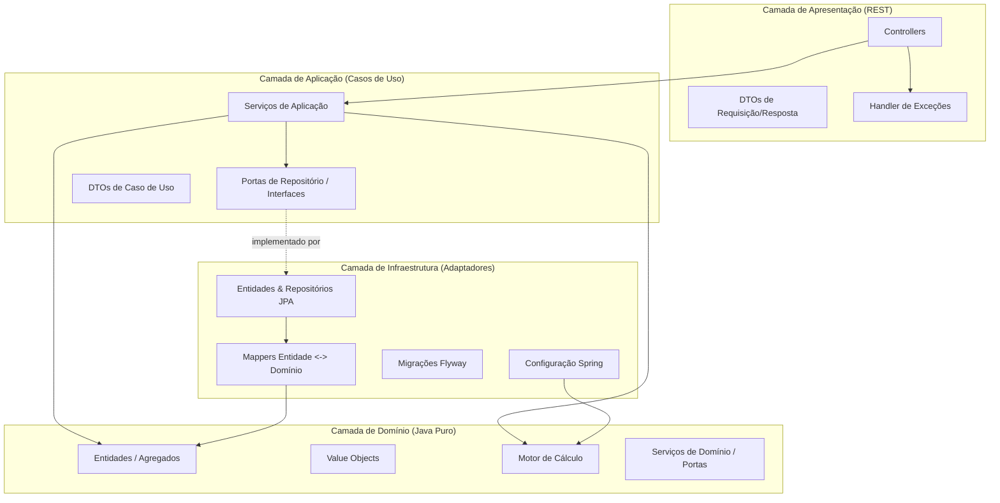
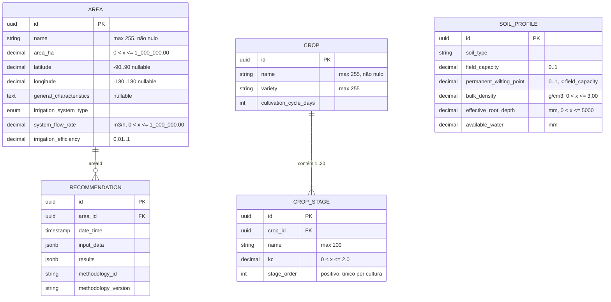

# Documento de Design

## Visão Geral

O **irrigation-management-backend** é um backend SaaS para manejo de irrigação agrícola. Esta primeira fase entrega uma API REST exclusivamente de backend que permite aos agrônomos cadastrar áreas de cultivo, culturas (com estágios de desenvolvimento e coeficientes de cultura) e parâmetros de solo, e que expõe um motor de cálculo de irrigação extensível além de um armazenamento de histórico de recomendações. Autenticação, multi-tenancy e frontend estão explicitamente fora de escopo; a arquitetura é um monólito modular preparado para evolução futura.

O design segue os princípios de Clean Architecture e DDD Pragmático. O sistema é organizado em quatro camadas — Domínio, Aplicação, Infraestrutura e Apresentação — com dependências apontando estritamente para dentro. A camada de Domínio (entidades, value objects e o motor de cálculo) é Java puro agnóstico a framework, de modo que o motor de cálculo possa funcionar sem nenhuma dependência de Spring ou JPA (Requisito 4.1). A camada de Infraestrutura adapta o domínio ao PostgreSQL via JPA e Flyway; a camada de Apresentação expõe endpoints REST sob `/api/v1` com DTOs separados de requisição e resposta; a camada de Aplicação orquestra casos de uso através de portas de repositório.

Um objetivo central do design é entregar contratos e estrutura completos agora enquanto difere as fórmulas agronômicas concretas (Item em Aberto 1). O motor de cálculo é construído como um Strategy + Registry extensível: um contrato `Calculation_Method` que futuras metodologias implementam e registram, sem tocar nas camadas REST ou de persistência.

### Stack Tecnológica

- **Linguagem/Runtime:** Java 21
- **Framework:** Spring Boot 3.x (estável mais recente 3.3+)
- **Build:** Gradle com Kotlin DSL (`build.gradle.kts`)
- **Persistência:** Spring Data JPA / Hibernate, PostgreSQL
- **Migrações:** Flyway
- **Validação:** Jakarta Bean Validation
- **Mapeamento:** MapStruct (mapeamento de DTO em tempo de compilação); Lombok apenas onde agrega valor
- **Documentação da API:** Springdoc OpenAPI
- **Testes:** JUnit 5, Mockito, jqwik (baseado em propriedades), Testcontainers (PostgreSQL), JaCoCo (cobertura ≥ 80%)
- **Containerização:** Docker (Dockerfile multi-stage), Docker Compose (backend + PostgreSQL)

### Pesquisa e Referências

As seguintes fontes informaram as decisões técnicas principais:

- Testes baseados em propriedades em Java com **jqwik** — anotações `@Property`/`@ForAll` e a API de geradores `Arbitraries` integram-se ao JUnit 5 ([Baeldung](https://www.baeldung.com/java-jqwik-property-based-testing), [jqwik.net](https://github.com/jqwik-team/jqwik.net)).
- Suporte nativo a **Problem Details** RFC 7807 no Spring Boot 3 via classe `ProblemDetail`, habilitado com `spring.mvc.problemdetails.enabled=true`, com um mapa `properties` extensível para erros de validação de campo ([Siva Labs](https://www.sivalabs.in/blog/spring-boot-3-error-reporting-using-problem-details/), [howtodoinjava](https://howtodoinjava.com/spring-mvc/spring-problemdetail-errorresponse/)).
- **Clean Architecture / Hexagonal + DDD** com Spring Boot — pacotes em camadas com dependências apontando para dentro e interfaces de porta ([Baeldung](https://www.baeldung.com/hexagonal-architecture-ddd-spring)).
- **MapStruct** — mapeamento entidade↔DTO em tempo de compilação e type-safe usando `@Mapper(componentModel = "spring")` ([Auth0](https://auth0.com/blog/how-to-automatically-map-jpa-entities-into-dtos-in-spring-boot-using-mapstruct/)).
- **Testcontainers** com `@ServiceConnection` (Spring Boot 3.1+) para PostgreSQL auto-configurado em testes de integração.

### Reconhecimento dos Itens em Aberto

O documento de requisitos registra 11 itens em aberto. Este design adota os defaults propostos para que a estrutura esteja completa, mas toda escolha é reversível e isolada, de modo que uma confirmação posterior pode alterar uma unidade, formato ou fonte sem um grande refactor:

1. **Fórmulas agronômicas** — deferidas; apenas o contrato `Calculation_Method`, o registry e a validação são construídos agora. Nenhuma fórmula é inventada por suposição.
2. **Unidade de vazão do sistema** — metros cúbicos por hora (m³/h), modelada como um value object para que a unidade possa ser alterada centralmente.
3. **Unidades dos parâmetros de solo** — conteúdo de água volumétrico (0,00–1,00) para capacidade de campo/ponto de murcha, g/cm³ para densidade aparente, milímetros para profundidade efetiva de raízes e água disponível. Cada parâmetro carrega um `MeasurementUnit` explícito.
4. **Localização geográfica** — latitude/longitude em graus decimais (WGS84), lat −90..90, lon −180..180.
5. **Tipo de sistema de irrigação** — um enum (`SPRINKLER`, `DRIP`, `MICRO_SPRINKLER`, `FURROW`, `CENTER_PIVOT`, `SURFACE`).
6. **Parâmetros agronômicos da cultura** — modelados através de entradas `Crop_Stage`; um ponto de extensão flexível de chave-valor é deixado em `Crop` se necessário posteriormente.
7. **Estágios de desenvolvimento da cultura** — cada estágio tem nome, Kc e ordem sequencial (o ciclo de cultivo em dias fica em `Crop`).
8. **Ciclo de cultivo** — duração em dias em `Crop`.
9. **Fonte de ETo** — ETo é um parâmetro de entrada em `Calculation_Input`; a fonte (manual, dados meteorológicos, API externa) é deferida e não afeta o contrato.
10. **Fonte de precipitação efetiva** — da mesma forma um parâmetro de entrada em `Calculation_Input`; fonte deferida.
11. **Eficiência do sistema de irrigação** — um atributo de `Area` associado ao sistema de irrigação, e também um parâmetro de entrada em `Calculation_Input`.

## Arquitetura

A aplicação é um **monólito modular** estruturado com Clean Architecture / DDD Pragmático. Existem quatro camadas, e a regra de dependência é estrita: camadas externas dependem de camadas internas, nunca o inverso. A camada de Domínio não depende de nada além do JDK.



### Responsabilidades das Camadas

- **Domínio** (`com.irrigation.domain`): Java puro, sem imports de Spring/JPA. Contém agregados (`Area`, `Crop`, `Soil_Profile`, `Recommendation`), value objects com invariantes (`AreaInHectares`, `FlowRate`, `GeographicLocation`, `Kc`, `VolumetricWaterContent`, `BulkDensity`, `RootDepth`, `Calculation_Input`, `Calculation_Result`), enums (`IrrigationSystemType`, `MeasurementUnit`), interfaces de portas de repositório, o motor de cálculo (contrato `Calculation_Method`, registry `Calculation_Engine`) e exceções de domínio. Todas as regras de negócio e validações de intervalo vivem aqui para que sejam testáveis isoladamente.
- **Aplicação** (`com.irrigation.application`): serviços de aplicação (casos de uso) que orquestram objetos de domínio através de portas de repositório — `Area_Service`, `Crop_Service`, `Soil_Service`, `Recommendation_Service`. Também contém DTOs de caso de uso e abstrações de paginação. Esta camada depende apenas da camada de Domínio.
- **Infraestrutura** (`com.irrigation.infrastructure`): adaptadores que implementam as portas de repositório usando Spring Data JPA. Contém modelos de persistência `@Entity` JPA (separados dos modelos de domínio), repositórios Spring Data, mappers manuais entre modelos de persistência e modelos de domínio, scripts de migração Flyway, configuração de JPA/datasource e configuração Spring que wired o motor de cálculo (registrando beans `Calculation_Method` no `Calculation_Engine`).
- **Apresentação** (`com.irrigation.presentation`): classes `@RestController` sob `/api/v1`, DTOs separados de requisição e resposta (modelos de transporte), mappers MapStruct entre DTOs de transporte e DTOs de caso de uso/modelos de domínio, e o handler de exceções centralizado `@RestControllerAdvice`. Depende apenas das camadas de Aplicação e Domínio.

### Decisões Arquiteturais Principais

1. **Separação two-model (Modelo de Domínio vs Modelo de Persistência).** Agregados de domínio são POJOs simples com regras de negócio; a persistência é tratada por classes `@Entity` JPA separadas na camada de Infraestrutura, mapeadas de/para o domínio por mappers manuais (ver "Mappers"). Justificativa: mantém o Domínio agnóstico a framework e totalmente testável unitariamente (suporta diretamente o Requisito 4.1 e o requisito de testabilidade), ao custo de código de mapeamento extra, coberto por testes de round-trip. Este é o tradeoff de DDD Pragmático escolhido em vez de anotar objetos de domínio com JPA.
2. **Independência do motor de cálculo.** `domain.calculation` tem zero imports de framework. O motor é um registry puro; implementações de `Calculation_Method` são beans Spring apenas no boundary de wiring (configuração de Infraestrutura), de modo que o contrato de domínio nunca referencie Spring.
3. **Ports and adapters para repositórios.** Interfaces de repositório vivem na camada de Domínio como portas; implementações JPA vivem em Infraestrutura. Isso inverte a dependência de persistência e permite que serviços de aplicação sejam testados unitariamente com portas simples em memória ou mockadas.
4. **Monólito modular, preparado para o futuro.** Todos os colaboradores cruzam boundaries de camada através de interfaces, de modo que autenticação, multi-tenancy e integrações externas podem ser adicionadas posteriormente (ex.: um filtro de auth em Apresentação, um contexto de tenant em Aplicação, adaptadores de API externa em Infraestrutura) sem reestruturação.
5. **Strategy + Registry para metodologias de cálculo.** Novas metodologias são adicionadas como novos beans `Calculation_Method` auto-registrados no motor; implementações existentes nunca são modificadas (Requisitos 4.3, 4.9).

### Estrutura de Pacotes

```
com.irrigation
├── IrrigationApplication.java                 # @SpringBootApplication entry point
├── domain                                      # Java puro — sem deps de framework
│   ├── model
│   │   ├── Area.java                            # aggregate root
│   │   ├── Crop.java                            # aggregate root
│   │   ├── CropStage.java                       # parte do agregado Crop
│   │   ├── SoilProfile.java                     # aggregate root
│   │   ├── Recommendation.java                  # aggregate root (registro de cálculo)
│   │   ├── valueobjects/
│   │   │   ├── AreaInHectares.java
│   │   │   ├── FlowRate.java
│   │   │   ├── GeographicLocation.java
│   │   │   ├── Kc.java
│   │   │   ├── VolumetricWaterContent.java
│   │   │   ├── BulkDensity.java
│   │   │   ├── RootDepth.java
│   │   │   ├── AvailableWater.java
│   │   │   ├── IrrigationEfficiency.java
│   │   │   ├── CalculationInput.java            # value object (Req 4.8)
│   │   │   └── CalculationResult.java           # value object (Req 4.7)
│   │   └── enums/
│   │       ├── IrrigationSystemType.java
│   │       └── MeasurementUnit.java
│   ├── calculation
│   │   ├── CalculationMethod.java               # contrato (interface)
│   │   ├── CalculationEngine.java               # registry (serviço de domínio)
│   │   ├── MethodologyIdentifier.java
│   │   └── exception/
│   │       ├── MethodologyNotAvailableException.java
│   │       ├── DuplicateMethodologyException.java
│   │       └── InvalidCalculationInputException.java
│   ├── repository/                              # portas
│   │   ├── AreaRepository.java
│   │   ├── CropRepository.java
│   │   ├── SoilProfileRepository.java
│   │   └── RecommendationRepository.java
│   └── exception/
│       ├── DomainException.java                 # base
│       ├── EntityNotFoundException.java         # -> 404
│       └── BusinessRuleException.java           # -> 422
├── application
│   ├── service/
│   │   ├── AreaService.java
│   │   ├── CropService.java
│   │   ├── SoilProfileService.java
│   │   └── RecommendationService.java
│   ├── dto/                                     # DTOs de caso de uso
│   └── pagination/
│       └── PagedResult.java
├── infrastructure
│   ├── persistence/
│   │   ├── entity/                              # classes @Entity JPA
│   │   ├── repository/                          # Spring Data JPA + impls de porta
│   │   └── mapper/                              # persistência <-> domínio (manuais)
│   ├── migration/                               # -> resources/db/migration (Flyway)
│   └── config/
│       ├── JpaConfig.java
│       └── CalculationEngineConfig.java         # registra beans CalculationMethod
└── presentation
    ├── controller/
    │   ├── AreaController.java
    │   ├── CropController.java
    │   ├── SoilProfileController.java
    │   ├── RecommendationController.java
    │   └── HealthController.java
    ├── dto/                                     # DTOs de transporte requisição/resposta
    ├── mapper/                                  # DTO <-> DTO caso de uso / domínio (MapStruct)
    └── advice/
        └── GlobalExceptionHandler.java          # @RestControllerAdvice
```

## Componentes e Interfaces

### Camada de Domínio

**Agregado `Area`** — raiz contendo nome, `AreaInHectares`, `GeographicLocation` opcional, características gerais, `IrrigationSystemType`, `FlowRate` e `IrrigationEfficiency`. A construção e atualização aplicam os invariantes dos Requisitos 1.12–1.16 no próprio domínio (para que valham independente do ponto de entrada).

**Agregado `Crop`** — raiz contendo nome, variedade, ciclo de cultivo (dias) e uma coleção de 1–20 entradas `CropStage`. Aplica contagem de estágios, intervalo de Kc e unicidade de ordem sequencial (Requisitos 2.11–2.13).

**`CropStage`** — valor dentro do agregado `Crop`: nome (≤ 100), Kc (> 0, ≤ 2,0), ordem (positiva, única dentro da cultura).

**Agregado `SoilProfile`** — raiz contendo tipo de solo, capacidade de campo `VolumetricWaterContent`, ponto de murcha permanente `VolumetricWaterContent` (CC > PMP), `BulkDensity`, `RootDepth`, `AvailableWater` e um `MeasurementUnit` explícito por parâmetro (Requisito 3.14). Aplica os Requisitos 3.10–3.13.

**Agregado `Recommendation`** — raiz representando um registro de cálculo persistido: id, `areaId`, `dateTime`, `CalculationInput`, `CalculationResult`, `MethodologyIdentifier`, versão da metodologia. Imutável após criação (Requisito 5.7).

**`Calculation_Engine`** — serviço de domínio que mantém um registry `Map<MethodologyIdentifier, CalculationMethod>`. Interface:

```java
public interface CalculationEngine {
    void register(CalculationMethod method);                    // Req 4.3, 4.10
    CalculationResult calculate(MethodologyIdentifier id, CalculationInput input); // Req 4.5
}
```

Comportamento:
- `calculate` primeiro **valida** os intervalos do `CalculationInput` (Requisito 4.11). Qualquer parâmetro ausente ou fora do intervalo lança `InvalidCalculationInputException` nomeando os parâmetros ofensores, e o cálculo **não** é executado.
- Se o id da metodologia não estiver registrado, lança `MethodologyNotAvailableException` (Requisito 4.6).
- Caso contrário, delega para `CalculationMethod.calculate(input)` (Requisito 4.5).
- `register` lança `DuplicateMethodologyException` se o id já existir e **preserva o registro existente inalterado** (Requisito 4.10). Novos registros não exigem modificação de implementações existentes (Requisito 4.9).

**Contrato `CalculationMethod`:**

```java
public interface CalculationMethod {
    MethodologyIdentifier methodologyId();
    String version();
    CalculationResult calculate(CalculationInput input);
}
```

**Value object `CalculationInput`** — contém os parâmetros do Requisito 4.8 (ETo, Kc, ETc, precipitação efetiva, umidade atual do solo, capacidade de armazenamento de água, eficiência do sistema de irrigação, lâmina líquida/bruta de irrigação, área irrigada, vazão do sistema, tempo de irrigação), cada um com seu intervalo validado como um value object fortemente tipado. A construção valida os intervalos.

**Value object `CalculationResult`** — contém `Irrigation_Depth` (0–500 mm), `Water_Volume` (0–999999,99 m³), `Irrigation_Time` (0–999,99 h) (Requisito 4.7). A construção valida os intervalos.

**Portas de repositório** — interfaces `AreaRepository`, `CropRepository`, `SoilProfileRepository`, `RecommendationRepository` no domínio, declarando métodos save/findById/delete/count e consultas filtradas/paginadas (ex.: `RecommendationRepository.findByAreaAndDateRange(areaId, from, to, pageable)`).

### Camada de Aplicação

**`Area_Service`** — orquestra create/update/delete/get/list para áreas. Delega persistência ao `AreaRepository`; verifica integridade referencial antes da exclusão (se a área for referenciada por recomendações, lança `BusinessRuleException` → 422, Requisito 1.19). Paginação: padrão página 0, tamanho 20, máximo 100; ordenável por nome e hectares (Requisitos 1.3–1.5).

**`Crop_Service`** — create/update/delete/get/list para culturas. Paginação: padrão página 0, tamanho 20, intervalo de tamanho 1–100 (Requisitos 2.3–2.4). Valida coleção de estágios e valores de Kc.

**`Soil_Service`** — create/update/delete/get/list para perfis de solo. Valida CC > PMP, densidade aparente, profundidade de raízes (Requisitos 3.10–3.13). Paginação: padrão tamanho 20, máximo 100 (Requisito 3.3).

**`Recommendation_Service`** — realiza um cálculo através do `Calculation_Engine`, armazena uma `Recommendation` e suporta consultas paginadas filtradas por área, por intervalo de datas ou ambos (máximo 100 por página, Requisitos 5.1–5.4, 5.8). Obtenção por id (5.5–5.6). Recomendações armazenadas nunca são modificadas quando a metodologia muda (5.7).

### Camada de Apresentação

**Controllers REST** sob `/api/v1`:

| Método | Caminho | Propósito |
|--------|---------|-----------|
| POST | `/api/v1/areas` | Criar área → 201 (Req 1.1) |
| GET | `/api/v1/areas` | Listar áreas, paginado + ordenável (Req 1.3–1.5, 1.18) |
| GET | `/api/v1/areas/{id}` | Obter área → 200 / 404 (Req 1.6–1.7) |
| PUT | `/api/v1/areas/{id}` | Atualizar área → 200 / 404 / 400 (Req 1.8–1.9) |
| DELETE | `/api/v1/areas/{id}` | Excluir área → 204 / 404 / 422 (Req 1.10–1.11, 1.19) |
| POST | `/api/v1/crops` | Criar cultura → 201 (Req 2.1) |
| GET | `/api/v1/crops` | Listar culturas, paginado (Req 2.3–2.4, 2.15) |
| GET | `/api/v1/crops/{id}` | Obter cultura → 200 / 404 (Req 2.5–2.6) |
| PUT | `/api/v1/crops/{id}` | Atualizar cultura → 200 / 404 / 400 (Req 2.7–2.8, 2.16) |
| DELETE | `/api/v1/crops/{id}` | Excluir cultura → 204 / 404 (Req 2.9–2.10) |
| POST | `/api/v1/soil-profiles` | Criar perfil de solo → 201 (Req 3.1) |
| GET | `/api/v1/soil-profiles` | Listar perfis de solo, paginado (Req 3.3) |
| GET | `/api/v1/soil-profiles/{id}` | Obter perfil de solo → 200 / 404 (Req 3.4–3.5) |
| PUT | `/api/v1/soil-profiles/{id}` | Atualizar perfil de solo → 200 / 404 / 400 (Req 3.6–3.7, 3.15) |
| DELETE | `/api/v1/soil-profiles/{id}` | Excluir perfil de solo → 204 / 404 (Req 3.8–3.9) |
| POST | `/api/v1/recommendations/calculate` | Executar cálculo + armazenar recomendação → 201 / 400 / 404 / 422 (Req 5.1, 4.6, 4.11) |
| GET | `/api/v1/recommendations` | Listar recomendações, filtrar por `areaId` e/ou `dateFrom`/`dateTo`, paginado → 200 (Req 5.2–5.4, 5.8) |
| GET | `/api/v1/recommendations/{id}` | Obter recomendação → 200 / 404 (Req 5.5–5.6) |
| GET | `/api/v1/health` | Status de saúde (Req 9.1–9.3) |
| GET | `/api/v1/openapi` | Documento OpenAPI (Req 12.3) |

O endpoint `POST /api/v1/recommendations/calculate` aceita `{ areaId, methodologyId, inputs }`, invoca o `Calculation_Engine` e, em caso de sucesso, persiste e retorna a `Recommendation` com 201. A rota usa um subrecurso (`/calculate`) em vez da notação `recommendations:calculate` prevista originalmente, por ser a forma suportada nativamente pelo mapeamento do Spring MVC. As verificações seguem a ordem: validação da requisição (400), existência da área (404), parâmetros do motor (400) e metodologia registrada (422). Como nenhum `Calculation_Method` concreto está registrado nesta fase (fórmulas deferidas, Item em Aberto 1), uma requisição nomeia uma metodologia não registrada e recebe corretamente `MethodologyNotAvailableException` (→ 422) — um comportamento deliberadamente validado (Requisito 4.6). Quando uma metodologia for adicionada posteriormente como um bean Spring, o mesmo endpoint funciona ponta-a-ponta sem alteração no controller.

**DTOs** — DTOs separados de requisição e resposta por operação (Requisito 6.2), implementados como Java records onde a imutabilidade ajuda. Endpoints de coleção retornam um `PagedResponse<T>` carregando `page`, `size`, `totalElements`, `totalPages` e `content` (Requisito 6.3). Anotações de Bean Validation nos DTOs de requisição provêm uma primeira linha de defesa (não-nulo, tamanho, intervalo); os value objects de domínio provêm a validação autoritativa e independente de framework.

**`GlobalExceptionHandler` (`@RestControllerAdvice`)** — centraliza o mapeamento exceção → ProblemDetail (ver Tratamento de Erros). Constrói respostas RFC 7807 `application/problem+json`, adicionando uma extensão `violations` para erros de validação de campo.

### Camada de Infraestrutura

**Modelos de persistência JPA** — `AreaEntity`, `CropEntity`, `CropStageEntity`, `SoilProfileEntity`, `RecommendationEntity` (classes `@Entity` em `infrastructure.persistence.entity`), separados dos modelos de domínio. Repositórios Spring Data JPA em `infrastructure.persistence.repository` implementam as portas de domínio.

**Mappers** — Dois conjuntos, com estratégias diferentes:

- `infrastructure.persistence.mapper` (modelo de persistência ↔ modelo de domínio): **mappers manuais**, classes `@Component` com `toDomain`/`toEntity`. Os agregados e value objects de domínio são imutáveis e validados no construtor (records e classes sem setters), o que não se encaixa bem no modelo de geração do MapStruct; o mapeamento manual reconstrói cada value object pelo construtor, aplicando suas invariantes, e trata explicitamente os campos opcionais (localização geográfica só quando latitude e longitude existem; Kc e eficiência opcionais no snapshot JSONB). O `RecommendationPersistenceMapper` converte para os records `CalculationInputJson`/`CalculationResultJson`, gravados em JSONB via `@JdbcTypeCode(SqlTypes.JSON)`. A correção é garantida por testes de round-trip unitários e de integração.
- `presentation.mapper` (DTO de transporte ↔ DTO de caso de uso / domínio): **MapStruct**, com `@Mapper(componentModel = "spring", unmappedTargetPolicy = ERROR)`, gerando beans Spring em tempo de compilação e falhando o build se algum campo ficar sem mapeamento.

**Migrações Flyway** — scripts versionados sob `src/main/resources/db/migration` (`V1__init_schema.sql`, …), criando as tabelas `areas`, `crops`, `crop_stages`, `soil_profiles` e `recommendations` (Requisito 8.3). A tabela `recommendations` realiza os "registros de cálculo" do Requisito 8.3: cada recomendação armazenada é um registro de cálculo persistido carregando dados de entrada, resultados, id de metodologia e versão. O Flyway executa migrações pendentes em ordem crescente de versão na inicialização, antes de a aplicação aceitar requisições (Requisitos 8.1–8.2); uma migração falha interrompe a inicialização e reporta a versão falha (Requisito 8.5).

Migrações posteriores à V1:

- **V2:** adiciona as colunas de unidade em `soil_profiles` (Requisito 3.14) e torna `uq_crop_stage_order` `DEFERRABLE INITIALLY DEFERRED`, porque ao substituir os estágios de uma cultura o Hibernate insere os novos antes de remover os antigos.
- **V3:** as colunas de auditoria `created_at`/`updated_at` (`areas`, `crops`, `soil_profiles`) passam a ser mantidas exclusivamente pelo banco. As entidades JPA não as mapeiam, e elas não são expostas pela API (nenhum requisito as exige). Os defaults usam `now() AT TIME ZONE 'UTC'`, porque as colunas são `TIMESTAMP` sem fuso e `now()` seria convertido para o fuso da sessão, definido pelo driver a partir da JVM. Um trigger `BEFORE UPDATE` (função `set_updated_at()`) atualiza `updated_at` apenas quando o conteúdo da linha muda (`OLD.* IS DISTINCT FROM NEW.*`). Alternativas consideradas: `@UpdateTimestamp` do Hibernate (usa o relógio da JVM e exige configurar o fuso do JDBC), datas no domínio expostas na API (amplia o escopo sem requisito) e remoção das colunas (perde a auditoria). Limitação conhecida: alterar somente os estágios de uma cultura não altera a linha de `crops` e não atualiza `crops.updated_at`.

**`CalculationEngineConfig`** — `@Configuration` Spring que coleta todos os beans `CalculationMethod` e os registra no bean único `CalculationEngine` na inicialização. Este é o único ponto onde o motor de domínio puro encontra o Spring, mantendo o contrato livre de framework.

**Health & observabilidade** — Spring Boot Actuator provê `/actuator/health`; `HealthController` adicionalmente expõe a redação acordada em `/api/v1/health` ("healthy"/"unhealthy", banco "connected"/"disconnected", "degraded" quando o banco está inacessível, Requisitos 9.1–9.3). Logging estruturado em JSON (timestamp, severidade ERROR/WARN/INFO, mensagem) é configurado via logging estruturado do Spring Boot (encoder JSON Logback); exceções são logadas com tipo, mensagem e stack trace (Requisito 7.5) mas nunca expostas no corpo da resposta 500 (Requisito 7.4).

**Containerização e configuração** — O build produz um **Dockerfile multi-stage**: estágio 1 constrói o fat JAR com Gradle no JDK 21, estágio 2 executa em uma imagem base JRE 21 slim (`eclipse-temurin`) como usuário não-root. O arquivo **Docker Compose** define dois serviços — `irrigation-backend` e `postgresql` — com o backend `depends_on` do serviço PostgreSQL e um healthcheck `condition: service_healthy`, de modo que o backend inicia apenas quando o banco aceita conexões (Requisitos 11.2–11.3). A configuração é **externalizada** através de `application.yml` mais as substituições de variáveis de ambiente via relaxed binding do Spring (ex.: `SPRING_DATASOURCE_URL`, `SPRING_DATASOURCE_USERNAME`, `SPRING_DATASOURCE_PASSWORD`), permitindo diferentes valores por ambiente sem alterações de código (Requisito 11.4). Credenciais de banco são **carregadas de variáveis de ambiente em tempo de execução** (Requisito 11.5); o repositório contém apenas um template `.env.example` e regras `.gitignore`, nunca valores reais de credenciais (Requisito 11.6).

## Modelos de Dados

### Relacionamento de Entidades



### Notas do Modelo de Dados

- **Identificadores** são UUIDs (gerados pelo banco), fornecendo referências estáveis independentes da ordem de inserção.
- **Recommendation.input_data / results** são armazenados como colunas JSONB (PostgreSQL) serializando `CalculationInput` / `CalculationResult`. Isso torna cada recomendação um snapshot autocontido e imutável (Requisito 5.7) que sobrevive a mudanças de metodologia.
- **Integridade referencial** — `recommendations.area_id` é uma FK para `areas(id)`. Excluir uma área referenciada por recomendações é bloqueado pelo `Area_Service` (→ 422, Requisito 1.19). `Crop` e `Soil_Profile` são agregados standalone sem FK de recomendações; sua exclusão é irrestrita (Requisitos 2.9, 3.8).
- **Registros de cálculo** (Requisito 8.3) são realizados pela tabela `recommendations`; nenhuma tabela separada é necessária porque cada recomendação persiste a entrada completa, resultado, metodologia e versão do cálculo.
- **Unidades** são explícitas no domínio (value objects e enum `MeasurementUnit`) e implícitas nos tipos/nomes das colunas na persistência; o design evita armazenar números sem unidade na camada de domínio (Requisito 3.14).
- **JPA `ddl-auto`** é definido como `validate` para que o Flyway seja a única fonte de verdade do schema; o Hibernate apenas verifica conformidade na inicialização.

### Modelo de Paginação e Ordenação

`PagedResult<T>` (aplicação) e `PagedResponse<T>` (apresentação) carregam `page` (base-0), `size`, `totalElements`, `totalPages` e `content`. O `Pageable` do Spring sustenta as consultas. Defaults: página 0, tamanho 20; máximo 100. Áreas podem ordenar apenas por `name` e `areaHectares` (Requisito 1.5). Parâmetros inválidos de paginação/ordenação produzem 400 Problem Details (Requisitos 1.18, 2.15).

## Propriedades de Correção

*Uma propriedade é uma característica ou comportamento que deve ser verdadeiro em todas as execuções válidas de um sistema — essencialmente, uma afirmação formal sobre o que o sistema deve fazer. Propriedades servem como ponte entre especificações legíveis por humanos e garantias de correção verificáveis por máquina.*

Como o motor de cálculo, os value objects de domínio, o registry de metodologias e a lógica de filtro/imutabilidade de recomendações são funções puras ou quase-puras cujo comportamento varia significativamente com a entrada e pode ser exercitado de forma barata em memória com jqwik, testes baseados em propriedades se aplicam a esta feature. Caminhos de sucesso/404 de CRUD, Flyway, health, Docker e conformidade OpenAPI são em vez cobertos por testes de exemplo, integração e smoke (ver Estratégia de Testes). As propriedades a seguir foram consolidadas a partir da análise de prework; padrões redundantes de aceitar/rejeitar entre value objects foram agrupados em propriedades únicas, e comportamentos complementares do motor foram mesclados.

### Propriedade 1: Value objects numéricos aplicam seus intervalos válidos

*Para qualquer* valor numérico usado para construir um value object de domínio — `AreaInHectares` (0 < x ≤ 1.000.000,00), `FlowRate` (0 < x ≤ 1.000.000,00), latitude do `GeographicLocation` (−90..90) e longitude (−180..180), `Kc` (0 < x ≤ 2,0), `VolumetricWaterContent` (0..1), `BulkDensity` (0 < x ≤ 3,00), `RootDepth` (0 < x ≤ 5000), parâmetros do `CalculationInput` (conforme intervalos do Requisito 4.8) e componentes do `CalculationResult` (lâmina 0–500, volume 0–999999,99, tempo 0–999,99) — a construção DEVE aceitar valores dentro do intervalo e rejeitar valores fora dele lançando um erro de validação que identifica o parâmetro ofensor, e o value object NUNCA deve existir em um estado fora do intervalo.

**Valida: Requisitos 1.14, 1.15, 1.16, 1.17, 2.13, 3.11, 3.12, 3.13, 4.7, 4.8**

### Propriedade 2: Value objects de texto aplicam presença e tamanho máximo

*Para qualquer* string usada para construir um value object de texto — nome da área, nome da cultura (cada um não em branco, ≤ 255) e nome do estágio de cultura (≤ 100) — a construção DEVE aceitar strings não em branco dentro do limite de tamanho e rejeitar strings em branco ou acima do limite com um erro de validação identificando o campo.

**Valida: Requisitos 1.13, 2.12, 2.14**

### Propriedade 3: Crop aplica contagem de estágios e ordem positiva única

*Para qualquer* coleção de estágios de cultura, a construção de `Crop` DEVE aceitar apenas quando o número de estágios está entre 1 e 20 inclusive e a ordem de cada estágio é um inteiro positivo único dentro da cultura; caso contrário a construção DEVE rejeitar com um erro de validação identificando a violação, e uma cultura válida NUNCA deve conter ordens de estágio duplicadas ou não positivas.

**Valida: Requisitos 2.11, 2.12**

### Propriedade 4: Capacidade de campo do solo excede estritamente o ponto de murcha permanente

*Para qualquer* perfil de solo, a capacidade de campo DEVE ser estritamente maior que o ponto de murcha permanente, com ambos os valores no intervalo 0..1, e a construção de `SoilProfile` DEVE rejeitar qualquer perfil onde a capacidade de campo seja menor ou igual ao ponto de murcha permanente, ou onde qualquer valor esteja fora do intervalo.

**Valida: Requisito 3.11**

### Propriedade 5: Todo parâmetro de solo carrega uma unidade de medida explícita

*Para qualquer* perfil de solo, todo parâmetro numérico (capacidade de campo, ponto de murcha permanente, densidade aparente, profundidade efetiva de raízes, água disponível) DEVE carregar um `MeasurementUnit` não nulo explícito, e a construção de um perfil com qualquer unidade ausente DEVE ser rejeitada.

**Valida: Requisito 3.14**

### Propriedade 6: Motor de cálculo rejeita entradas inválidas e não executa

*Para qualquer* requisição de cálculo cujo `CalculationInput` tenha parâmetros ausentes ou contenha parâmetros fora de seus intervalos válidos, o `Calculation_Engine` DEVE lançar `InvalidCalculationInputException` que identifica exatamente os parâmetros inválidos, e NÃO DEVE invocar o `CalculationMethod` alvo.

**Valida: Requisitos 4.11, 4.8**

### Propriedade 7: Motor de cálculo delega para metodologias registradas e rejeita ids não registrados

*Para qualquer* identificador de metodologia e entrada válida, se o identificador estiver registrado o `Calculation_Engine` DEVE retornar exatamente o resultado produzido pelo `CalculationMethod` correspondente (e esse método DEVE ser invocado exatamente uma vez), e se o identificador não estiver registrado o motor DEVE lançar `MethodologyNotAvailableException` e NÃO DEVE invocar nenhum método. Múltiplas metodologias com identificadores distintos DEVEM todas estar disponíveis concorrentemente.

**Valida: Requisitos 4.3, 4.5, 4.6**

### Propriedade 8: Registro de metodologia nunca altera registros existentes

*Para qualquer* sequência de operações de registro, registrar um novo `CalculationMethod` com um identificador inédito DEVE disponibilizá-lo sem alterar a disponibilidade ou o comportamento de qualquer metodologia já registrada, e registrar um método com um identificador já registrado DEVE lançar `DuplicateMethodologyException` e deixar o registro existente inalterado de modo que cálculos subsequentes ainda usem o método original.

**Valida: Requisitos 4.9, 4.10**

### Propriedade 9: Recomendação é um snapshot completo e imutável

*Para qualquer* cálculo realizado com sucesso, a `Recommendation` armazenada DEVE conter o identificador da recomendação, o identificador de área associado, data e hora, dados de entrada, resultados, identificador de metodologia e versão da metodologia correspondentes ao cálculo, e após o identificador ou versão da metodologia de cálculo mudar, toda recomendação armazenada anteriormente DEVE permanecer inalterada em seus dados de entrada armazenados, resultados, identificador de metodologia e versão de metodologia.

**Valida: Requisitos 5.1, 5.7**

### Propriedade 10: Filtros de recomendação retornam apenas registros correspondentes, página vazia quando nenhum corresponde

*Para qualquer* filtro de recomendação por identificador de área, por intervalo de datas ou por ambos, toda recomendação retornada DEVE corresponder a todos os critérios fornecidos (pertencer à área dada e/ou cair dentro do intervalo de datas dado), e quando nenhuma recomendação corresponde ao filtro, o serviço DEVE retornar uma coleção paginada vazia com HTTP 200.

**Valida: Requisitos 5.2, 5.3, 5.4, 5.8**

### Propriedade 11: Área referenciada por uma recomendação não pode ser excluída

*Para qualquer* área que seja referenciada por uma ou mais recomendações armazenadas, uma requisição de exclusão DEVE ser rejeitada com um erro de regra de negócio (HTTP 422) e NÃO DEVE alterar a área e suas recomendações referenciadoras; uma área sem recomendações referenciadoras DEVE ser excluível.

**Valida: Requisito 1.19**

### Propriedade 12: Metadados de paginação são consistentes entre endpoints de coleção

*Para qualquer* consulta de coleção, a resposta DEVE ser paginada com números de página iniciando em 0, tamanho de página padrão 20 e tamanho de página aceito apenas no intervalo 1..100 (valores fora dele, ou página negativa, são rejeitados com HTTP 400 e violações nos campos `page`/`size`, sem ajuste automático; Req 1.18 e 2.15), e metadados onde `totalPages` equals o teto de `totalElements / size`; solicitar um índice de página maior ou igual a `totalPages` DEVE retornar uma lista de conteúdo vazia com HTTP 200.

**Valida: Requisitos 1.3, 1.4, 2.3, 2.4, 3.3, 6.3**

### Propriedade 13: Ordenação de áreas é restrita a campos válidos e ordena os resultados conforme

*Para qualquer* requisição de listagem de áreas com um parâmetro de ordenação, quando o campo for `name` ou `areaHectares` as áreas retornadas DEVEM ser ordenadas por aquele campo, e quando o campo for qualquer outro valor a requisição DEVE ser rejeitada com HTTP 400.

**Valida: Requisitos 1.5, 1.18**

### Propriedade 14: Erros de validação retornam Problem Details RFC 7807 com violações de campo

*Para qualquer* requisição contendo dados inválidos, ausentes, malformados ou fora do intervalo, a API DEVE retornar HTTP 400 com uma resposta de content type `application/problem+json` contendo um título, status, detalhe e uma lista de erros de validação de campo onde cada entrada identifica o nome do campo e fornece uma descrição do erro.

**Valida: Requisitos 1.2, 2.2, 3.2, 6.8, 6.10, 7.1**

### Propriedade 15: Erros de não-encontrado e de regra de negócio retornam Problem Details RFC 7807 com status correto

*Para qualquer* requisição por um recurso inexistente, a API DEVE retornar HTTP 404 com um corpo `Problem_Details` contendo um título, status e detalhe identificando o recurso ausente; e para qualquer violação de regra de negócio, a API DEVE retornar HTTP 422 com um corpo `Problem_Details` contendo um título, status e detalhe descrevendo a regra violada.

**Valida: Requisitos 7.2, 7.3**

### Propriedade 16: Erros inesperados nunca vazam detalhes internos

*Para qualquer* erro inesperado, a API DEVE retornar HTTP 500 com um corpo `Problem_Details` contendo um título, status e um detalhe genérico, e o corpo NÃO DEVE conter um stack trace ou qualquer detalhe de implementação interno, mesmo que a exceção (tipo, mensagem, stack trace) seja logada no servidor.

**Valida: Requisitos 7.4, 6.9**

## Tratamento de Erros

O tratamento de erros é centralizado em um único `@RestControllerAdvice` (`GlobalExceptionHandler`) de modo que todo caminho de erro produza uma resposta RFC 7807 `application/problem+json` consistente. O suporte nativo a `ProblemDetail` do Spring Boot 3 é habilitado (`spring.mvc.problemdetails.enabled=true`) como base, e o handler o estende com uma extensão `violations` para erros de validação de campo.

### Mapeamento Exceção → Resposta

| Origem | Exceção (domínio/camada) | HTTP | Campos ProblemDetail |
|--------|--------------------------|-----|----------------------|
| Bean Validation em DTOs de requisição | `MethodArgumentNotValidException`, `ConstraintViolationException` | 400 | title, status, detail, `violations[]` (field + message) |
| Entrada de cálculo inválida | `InvalidCalculationInputException` | 400 | title, status, detail, `violations[]` (parameter + message) |
| Recurso não encontrado | `EntityNotFoundException` | 404 | title, status, detail (identifica recurso) |
| Metodologia não registrada | `MethodologyNotAvailableException` | 422 | title, status, detail |
| Metodologia duplicada | `DuplicateMethodologyException` | 422 | title, status, detail |
| Violação de regra de negócio (ex.: área referenciada) | `BusinessRuleException` | 422 | title, status, detail |
| Qualquer outra (inesperado) | `Exception` (catch-all) | 500 | title, status, detalhe genérico — sem stack trace |

### Decisões de Design

- **Fonte única de verdade para validação.** Bean Validation em DTOs de requisição é um portão rápido inicial, mas as regras autoritativas de intervalo/presença vivem nos value objects de domínio (Propriedades 1–5). O handler mapeia tanto falhas de validação de DTO quanto de domínio para o mesmo formato 400 `violations`, de modo que os clientes veem um contrato consistente independentemente de qual camada capturou o erro.
- **Extensão `violations`.** Erros de campo são serializados em `ProblemDetail.properties["violations"]` como um array de `{ "field": ..., "message": ... }`, satisfazendo a lista por campo do Requisito 7.1 mantendo os membros padrão do `ProblemDetail` intactos.
- **Sem internals no 500.** O handler catch-all loga a exceção completa (tipo, mensagem, stack trace) e retorna apenas um `detail` genérico como "An unexpected error occurred", satisfazendo as Propriedades 16 e o Requisito 7.4.
- **Semântica de status.** 400 = entrada malformada/inválida; 404 = recurso não encontrado; 422 = requisição bem-formada que viola uma regra de negócio (integridade referencial, metodologia não registrada/duplicada); 500 = falha inesperada. Isso mantém o caso de área referenciada (Requisito 1.19) em 422, consistente com uma violação de regra de negócio, em vez de 409.

### Logging Estruturado

Todas as exceções são logadas via logging estruturado em JSON (logging estruturado do Spring Boot / encoder JSON Logback). Cada entrada de log captura `timestamp`, `severity` (`ERROR` / `WARN` / `INFO`) e `message`; entradas de erro adicionalmente capturam `exceptionType`, `exceptionMessage` e o `stackTrace` completo (Requisito 7.5). Eventos informacionais da aplicação (criar/atualizar/excluir, cálculos) são logados em `INFO` com uma mensagem estruturada; falhas de validação/regra de negócio em `WARN`; erros inesperados em `ERROR`. Logs nunca incluem credenciais ou segredos de requisição.

## Estratégia de Testes

A suíte combina testes baseados em exemplo, baseados em propriedades, de integração e smoke, com JaCoCo enforceando um mínimo de 80% de cobertura de linha e asserções focadas em comportamento em vez de apenas cobertura (Requisito 10.7).

### Abordagem Dupla de Testes

- **Testes unitários + baseados em propriedades** verificam lógica de domínio pura e o motor de cálculo isoladamente.
- **Testes de integração** verificam a stack completa contra PostgreSQL via Testcontainers.
- **Testes de controller** verificam cada endpoint REST para respostas de sucesso e erro.
- **Testes smoke/estruturais** verificam configuração, migrações, containerização e conformidade de documentação.

### Testes Baseados em Propriedades (jqwik)

PBT é apropriado para o motor de cálculo e value objects de domínio (funções puras com grandes espaços de entrada). Os testes usam **jqwik** (`net.jqwik:jqwik`, escopo de teste) integrado ao JUnit 5, usando `@Property` + `@ForAll` com geradores `Arbitraries` (incluindo geradores customizados para intervalos de `BigDecimal` e o enum `MeasurementUnit`). Cada teste de propriedade executa um **mínimo de 100 iterações** e é tagueado para referenciar sua propriedade de design:

`// Feature: irrigation-management-backend, Property N: <texto da propriedade>`

Propriedades implementadas como testes jqwik, um teste por propriedade de design acima (Propriedades 1–16). Geradores devem cobrir casos de borda (limites, zero, negativos, valores muito grandes, strings em branco/acima do limite, ordens de estágio duplicadas, unidades ausentes). Testes do motor/registry usam implementações fake leves de `CalculationMethod`; testes de filtro/imutabilidade de recomendação usam um repositório em memória ou mocks para que a propriedade seja exercitada sem custo de AWS/externo.

### Testes Unitários (JUnit 5 + Mockito)

- Um ou mais testes por regra de negócio de entidade de domínio: pelo menos um caso válido e um inválido (Requisito 10.1) — cobrindo `Area`, `Crop`/`CropStage`, `SoilProfile`, `Recommendation` e o motor de cálculo.
- Um caminho de sucesso e um de erro por método de serviço de aplicação, com portas de repositório mockadas (Requisito 10.2).
- Mappers (MapStruct) e helpers de paginação.

### Testes de Controller (`@WebMvcTest` + MockMvc)

- Cada endpoint de controller REST coberto com no mínimo uma resposta de sucesso e uma de erro (Requisito 10.3), asserindo códigos de status, formato Problem Details e metadados de paginação.
- Testes de validação exercitando DTOs de requisição válidos e inválidos (Requisito 10.5).

### Testes de Integração (Testcontainers + PostgreSQL)

- `@SpringBootTest` com `@ServiceConnection` e um `PostgreSQLContainer` (Requisito 10.4): round-trips de repositório, exclusão com integridade referencial (Requisito 1.19), consultas filtradas de recomendação e o ciclo de vida completo de criar/listar/obter/atualizar/excluir.
- Migrações Flyway executam contra o contêiner: verificar que tabelas são criadas em ordem crescente de versão (Requisito 8.1/8.3), e uma migração deliberadamente falha interrompe a inicialização reportando a versão falha (Requisito 8.5).
- Endpoint de health reporta `connected` com o BD no ar e `degraded` quando o BD está inacessível (Requisito 9.3), e entradas de log JSON estruturadas são capturadas e verificadas (Requisitos 7.5, 9.4).

### Testes Smoke / Estruturais

- **Independência arquitetural** (Requisito 4.1): um teste estrutural (ex.: ArchUnit) afirma que `domain` (especialmente `domain.calculation`) não tem dependências de `presentation`, `infrastructure`, Spring ou JPA.
- **Versionamento da API** (Requisito 6.1): teste estrutural afirmando que todos os controllers mapeiam sob `/api/v1`.
- **OpenAPI** (Requisito 12): teste smoke fazendo GET no endpoint de docs e afirmando que todos os endpoints e esquemas de requisição/resposta estão presentes.
- **Containerização** (Requisito 11): testes smoke para o build/start do Dockerfile, grafo de serviços do Docker Compose e `depends_on`, override de configuração por variável de ambiente, e uma varredura do repositório afirmando que nenhum arquivo de credencial está commitado.
- **Versionamento de migrações** (Requisito 8.4): teste estrutural afirmando que as versões de migração são monotonicamente crescentes.

### Cobertura e Portões de Qualidade

- **JaCoCo** configurado em `build.gradle.kts` com um mínimo de 80% de cobertura de linha (Requisito 10.6), enforceado como verificação de build.
- Testes asserem resultados esperados e regras de negócio, não apenas cobertura (Requisito 10.7); testes de propriedade provêm ampla cobertura de entrada enquanto testes unitários/de integração fixam comportamentos concretos e pontos de integração.

### Notas de Configuração de Testes

- Testcontainers exige Docker disponível no ambiente de CI/local; testes de integração são tagueados para que possam ser pulados quando o Docker não estiver disponível enquanto testes unitários/de propriedade/de controller rodam em qualquer lugar.
- Testes jqwik vivem junto aos testes JUnit e são descobertos pelo engine do JUnit Platform; nenhum runner separado é necessário.

## Containerização e Configuração de Ambiente

Atende ao Requisito 11. Os detalhes de uso estão no `README.md`.

**Imagem (Dockerfile multi-stage, Req 11.1).**
- O estágio de build usa `eclipse-temurin:21-jdk` e executa `gradlew build`, que inclui `check`: testes unitários e a meta de cobertura. Os testes de integração ficam fora, porque exigiriam Docker dentro do build.
- O cache do Gradle é reaproveitado entre builds com `RUN --mount=type=cache` (BuildKit).
- O estágio de runtime usa `eclipse-temurin:21-jre` e contém só o JAR, executado por um usuário de sistema não-root (`app`). O JAR pertence ao root e é apenas lido pela aplicação.
- O `bootJar` gera um nome fixo (`irrigation-backend.jar`) e o JAR "plain" foi desligado, para o Dockerfile copiar um artefato inequívoco.
- O heap é limitado por `-XX:MaxRAMPercentage=75.0`, sobrescrevível pela variável `JAVA_OPTS`.

**Compose (Req 11.2, 11.3).**
- Dois serviços: `postgresql` (`postgres:16`, volume nomeado `postgres-data`) e `irrigation-backend`.
- O backend usa `depends_on` com `condition: service_healthy`. O healthcheck usa `pg_isready -h 127.0.0.1` (TCP): durante a inicialização da imagem oficial, o servidor temporário só escuta no socket local, então checar via socket marcaria o banco como pronto cedo demais.
- As portas são publicadas apenas em `127.0.0.1`. Isso evita expor banco e API na rede local e, no Docker Desktop para Windows, evita um listener IPv6 em `::1` que aceitava a conexão a `localhost` sem responder.

**Configuração externalizada e credenciais (Req 11.4 a 11.6).**
- O `application.yml` lê `SPRING_DATASOURCE_URL`, `SPRING_DATASOURCE_USERNAME` e `SPRING_DATASOURCE_PASSWORD`. Só a URL tem valor padrão (localhost), porque não é segredo. Usuário e senha não têm padrão, e o perfil `dev` deixou de redefinir o datasource.
- Sem as credenciais, a aplicação não inicia: o Spring Boot repassa o placeholder literal ao driver e o Flyway falha com `password authentication failed for user "${SPRING_DATASOURCE_USERNAME}"`.
- O compose usa a sintaxe `${VAR:?mensagem}` e recusa iniciar sem as credenciais, em vez de subir com uma senha padrão.
- O `.env.example` traz apenas valores de exemplo. O `.env` real fica fora do versionamento (`.gitignore`) e fora do contexto de build (`.dockerignore`).

**Alternativas consideradas.**
- *Imagem de runtime com `jlink` ou base distroless:* menor, mas foge do que a spec previu e complica a depuração. A imagem atual tem cerca de 565 MB, quase toda da JRE base.
- *Validação explícita das credenciais na inicialização (por exemplo, um `EnvironmentPostProcessor`):* daria uma mensagem mais direta, mas teria de distinguir o caso dos testes de integração, em que o `@ServiceConnection` fornece a conexão sem definir essas propriedades. Fica como melhoria possível.
