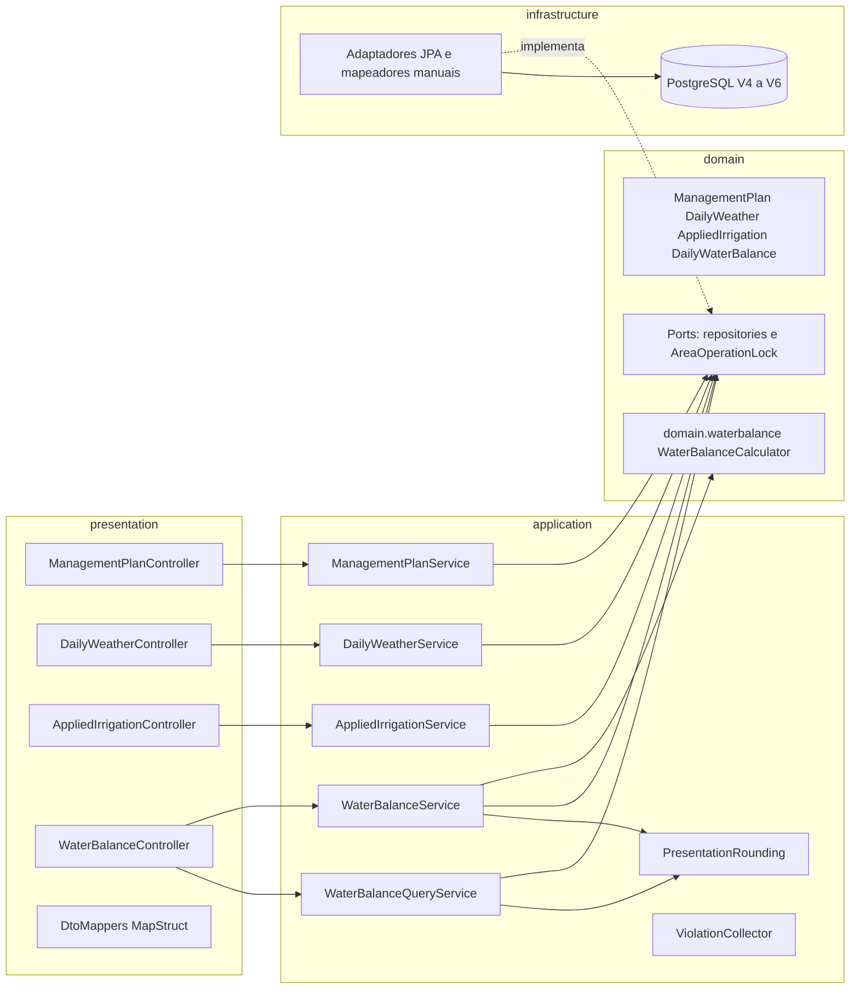
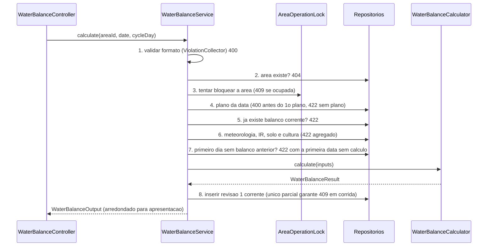
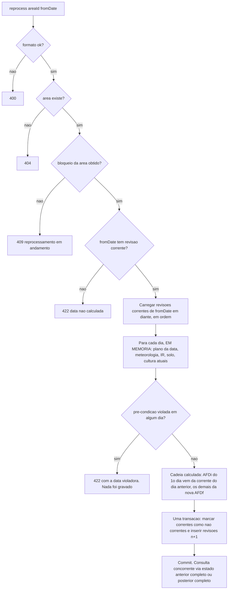
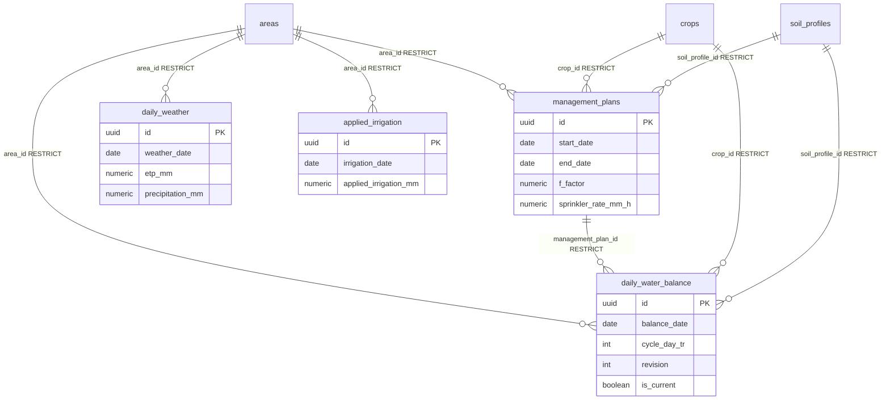

# Design Document

> Documento de design em pt-br. Os títulos de seção exigidos pelo validador de formato ficam em inglês. Identificadores de código ficam em inglês. Este documento não contém código de implementação.

## Overview

O módulo **irrigation-water-balance-module** estende o backend existente com quatro capacidades: plano de manejo por área, entrada diária de meteorologia (ETP e P), entrada diária da Irrigação Real (IR) e cálculo do balanço hídrico diário com o tempo de funcionamento do aspersor. O cálculo usa somente as fórmulas do `requirements.md` (seção 4). Nenhuma regra agronômica foi acrescentada neste design.

### Decisões que orientam o design

| Id | Decisão | Alternativa considerada e motivo da rejeição |
|---|---|---|
| DD-01 | O balanço diário é um registro **imutável com revisões**. Reprocessar cria uma nova revisão corrente e marca a anterior como não corrente (`is_current = false`). Nada é apagado nem sobrescrito. | **Atualização in-place** do registro do dia (sugerida em respostas da análise). Rejeitada: apaga o que foi usado no cálculo original, contraria RN-13 e o Requisito 12.7 (imutabilidade) e impede auditar por que a recomendação de ontem era diferente da de hoje. |
| DD-02 | O Reprocessamento é **tudo-ou-nada**, em uma única transação. Se qualquer dia violar uma pré-condição, nenhuma revisão é criada (Requisito 13.4 e 13.5). | **Processamento parcial** (gravar os dias bons e parar no primeiro ruim, sugerido em respostas da análise). Rejeitada: a AFDi de um dia é a AFDf do anterior. Gravar os dias iniciais e parar deixaria uma cadeia com um trecho novo e um trecho antigo, e o trecho antigo seria calculado sobre uma AFDf que já não existe. Uma consulta concorrente veria um estado que nunca foi correto. |
| DD-03 | O `WaterBalanceCalculator` é um serviço de domínio puro, em `com.irrigation.domain.waterbalance`, e **não** passa pelo `CalculationEngine` (DP-02). | Implementar um `CalculationMethod`. Rejeitada: o motor é sem estado, exige 12 campos que não existem neste cálculo e o balanço depende do dia anterior. |
| DD-04 | Entradas manuais em duas tabelas (`daily_weather` e `applied_irrigation`), uma linha por área e data, gravadas por **upsert atômico** no banco (DP-04). | Uma tabela só com colunas nulas. Rejeitada: perde a distinção entre "falta meteorologia" e "falta Irrigação Real" (Requisito 11.1 e 11.2). |
| DD-05 | O banco é a autoridade das invariantes de concorrência: índice único parcial para um balanço corrente por área e data, índice único parcial para um plano ativo por área, `UNIQUE` para meteorologia e IR, e trigger de imutabilidade. A aplicação traduz as violações em erros de domínio. | Controle só na aplicação. Rejeitada: não resiste a requisições concorrentes (Requisitos 4.8, 6.7, 12.9). |
| DD-06 | Exclusões de Área, Solo e Cultura referenciados são barradas por `FOREIGN KEY ... ON DELETE RESTRICT`, e o adaptador de persistência traduz a violação em `BusinessRuleException` (422). Os construtores dos serviços existentes não mudam. | Injetar novos repositórios nos serviços existentes para pré-verificar. Rejeitada: quebra a construção dos serviços nos testes existentes (por exemplo `new AreaService(areas)`) e a verificação seria sujeita a corrida. |
| DD-07 | Resultados calculados são persistidos em colunas `NUMERIC` **sem escala fixa**. Operating_Time usa `NUMERIC(24,10)`. | `NUMERIC(24,10)` para tudo (proposto no requisito 5.2). Rejeitada: ver "Precisão e escalas" em Data Models. |

As decisões DD-01 e DD-02 mantêm exatamente o que está no `requirements.md` (Requisitos 12 e 13).

### Pontos do requirements que o design interpreta ou ajusta

Estes itens precisam de confirmação do usuário na revisão do design. Nenhum bloqueia a leitura do restante.

| Id | Ponto | Tratamento adotado |
|---|---|---|
| A-01 | O Requisito 16.8 exige que os testes existentes passem sem alteração de asserções. Os Requisitos 1.6, 2.5 e 3.1 removem obrigatoriedades que testes existentes verificam (por exemplo `SoilProfileServiceTest.createRequiresEveryUnit`, e testes que exigem pelo menos um estágio de cultura ou os campos obrigatórios de área). | Os dois requisitos não podem ser cumpridos ao mesmo tempo para esses testes. O design adota: somente as asserções que codificam uma obrigatoriedade removida são alteradas, uma a uma, listadas no `tasks.md` e justificadas pelo Requisito correspondente. Os demais testes ficam intactos. Assinaturas de construtores de domínio e de records de DTO são mantidas por construtores de compatibilidade. |
| A-02 | Não há requisito para **encerrar** um plano, embora 4.10 oriente "encerrar o plano e criar outro" e 4.11 liste planos "encerrados". | O `PUT` do plano aceita `endDate` opcional. Regras novas: `endDate` não pode ser anterior a `startDate` nem ao último dia calculado; um novo plano deve começar depois do `endDate` de todos os planos anteriores da área (sem sobreposição). |
| A-03 | O Requisito 7.4 manda responder 400 para "data anterior ao início do plano", mas o 11.6 fixa a ordem 400, 404, 422. | O 400 por data anterior ao primeiro plano da área é avaliado logo depois da verificação da área (que é o primeiro ponto em que o plano é conhecido). Área sem nenhum plano gera 422 (Requisito 7.6). |
| A-04 | DP-03: o limite superior e a sequência de TR não estão definidos. | TR é validado como inteiro maior ou igual a 1, sem limite superior e sem verificar sequência. O valor é apenas registrado. O limite fica em uma constante única, para mudar em um lugar só se o usuário decidir. |
| A-05 | O Requisito 5 pede a data no corpo da requisição ("omitir a data"), enquanto os endpoints propostos a colocam no caminho. | Meteorologia e IR usam `POST` com a data no corpo (upsert). O 400 por data ausente passa a existir como `violations[]`. |
| A-06 | Corrida entre dois cálculos da mesma área e data, ou cálculo contra reprocessamento. | Resposta 409 (Requisitos 12.10 e 13.8). A duplicidade sem corrida continua sendo 422 (Requisito 11.7). |
| A-07 | Pares CC/PMP gravimétricos: o Requisito 1 só trata o par volumétrico incompleto. | O par gravimétrico também é "ambos ou nenhum" e `CC > PMP` quando presente (sem isso a regra não é verificável). Um só valor gera 400. |
| A-08 | KC e Z gravados em `NUMERIC(4,2)` e `NUMERIC(10,2)` arredondariam valores com mais casas sem aviso. | O domínio recusa KC e Z com mais de 2 casas decimais (400). Vale também para CC e PMP gravimétricos (`NUMERIC(5,2)`). |

## Architecture

O módulo segue as camadas existentes (`domain`, `application`, `infrastructure`, `presentation`) e as regras de dependência do `ArchitectureTest`. É um monólito modular (ADR-003): os novos componentes ficam nos mesmos pacotes por camada, com o cálculo isolado em um subpacote próprio do domínio.

### Regras de dependência

- `domain.waterbalance` depende apenas de `java.*`, `domain.model.valueobjects` e de seus próprios tipos. Não depende de Spring, Jakarta, Hibernate, Jackson, `domain.repository` nem `domain.calculation`.
- `application` usa portas de `domain.repository`. `infrastructure` implementa as portas. `presentation` não conhece `infrastructure`.
- Nenhuma classe existente de `domain.calculation`, `Recommendation` e do endpoint `/api/v1/recommendations/calculate` é alterada (Requisito 16.2).
- Nova regra de ArchUnit (acrescentada, sem enfraquecer as existentes): `domain.waterbalance` não depende de Spring, Jakarta, Hibernate, `..application..`, `..infrastructure..`, `..presentation..`, `..domain.repository..` nem `..domain.calculation..`. A regra existente `domainIsIndependentOfFrameworksAndOuterLayers` já cobre `domain.waterbalance` por estar sob `..domain..`.

### Sequência do cálculo diário

Os passos 1 a 3 seguem a ordem do Requisito 11.6 (formato, área, pré-condições). O bloqueio do passo 3 vem antes de qualquer leitura que dependa de estado, para que a verificação de duplicidade e a leitura do dia anterior sejam consistentes.

### Fluxo do Reprocessamento (tudo-ou-nada)

Todo o cálculo ocorre em memória antes de qualquer escrita. Só depois de a cadeia inteira estar válida a transação marca as revisões antigas como não correntes (um `UPDATE` em lote) e insere as novas. Uma exceção em qualquer ponto desfaz tudo (DD-02).

## Components and Interfaces

### Domínio: modelo e value objects

Agregados novos em `com.irrigation.domain.model` (sem setters, invariantes na construção, métodos estáticos `validateX` para que cada erro saia no campo certo, como em `Area` e `SoilProfile`):

| Tipo | Papel |
|---|---|
| `ManagementPlan` | `id`, `areaId`, `cropId`, `soilProfileId`, `startDate`, `endDate` (opcional), `AvailabilityFactor f`, `SprinklerRate sprinklerRate`. Operações: `updateParameters(f, rate)` e `close(endDate)`. |
| `DailyWeather` | `id`, `areaId`, `date`, `EtpDepth`, `PrecipitationDepth`. |
| `AppliedIrrigation` | `id`, `areaId`, `date`, `AppliedIrrigationDepth`. |
| `DailyWaterBalance` | Imutável. Identificação (`id`, `areaId`, `managementPlanId`, `cropId`, `soilProfileId`, `date`, `CycleDay`), `WaterBalanceInputs` (snapshot), `WaterBalanceResult`, controle (`calculatedAt`, `methodologyId`, `methodologyVersion`, `revision`, `current`). Única mudança permitida: `markNotCurrent()`, que devolve uma cópia com `current = false`. |
| `NoRecommendationReason` (enum) | `FIRST_DAY_OF_FIRST_CYCLE`. |

Value objects novos em `domain.model.valueobjects` (records validados, como `Kc` e `BulkDensity`):

| Value object | Regra |
|---|---|
| `GravimetricWaterContent` | 0 a 100 inclusive, no máximo 2 casas decimais (CC e PMP, em %). |
| `AvailabilityFactor` (F) | maior que 0 e no máximo 1, no máximo 4 casas decimais. Nunca dividido por 100. |
| `SprinklerRate` | maior que 0 e no máximo 500, no máximo 4 casas decimais, em mm/h. |
| `EtpDepth`, `PrecipitationDepth`, `AppliedIrrigationDepth` | 0 a 1.000 inclusive, no máximo 2 casas decimais, em mm. Três tipos para que a mensagem de erro cite o campo certo. |
| `CycleDay` (TR) | inteiro maior ou igual a 1 (A-04). |

Reutilizados sem mudança: `Kc` (0 a 2,0), `RootDepth` (0 a 5.000 mm, para Z da cultura) e `BulkDensity` (D, até 3,00).

Alterações nos agregados existentes (somente relaxamento e campos novos, com construtores de compatibilidade):

- `SoilProfile`: novos campos opcionais `fieldCapacityGravimetric` e `permanentWiltingPointGravimetric` (`GravimetricWaterContent`). Os campos volumétricos, a profundidade efetiva, a água disponível e as quatro unidades passam a aceitar nulo. `validateWaterContents` continua valendo quando o par volumétrico está presente, e há uma nova regra "ambos ou nenhum" para cada par (Requisito 1.7 e 1.8, A-07). `BulkDensity` continua obrigatório.
- `Crop`: novos campos opcionais `kc` (`Kc`) e `rootDepth` (`RootDepth`). `validateStages` passa a aceitar de 0 a 20 estágios (Requisito 2.5).
- `Area`: `areaHectares`, `irrigationSystemType` e `systemFlowRate` passam a aceitar nulo (Requisito 3.1). O nome continua obrigatório.

### Domínio: calculador puro

`com.irrigation.domain.waterbalance.WaterBalanceCalculator` é uma classe sem estado, sem dependências de framework e sem acesso a relógio ou banco.

- **Entrada** `WaterBalanceInputs`: ETP, P, IR, CC, PMP, D, Z, KC, F, Sprinkler_Rate, `firstDayOfPlan` e `previousAfdFinal` (obrigatória quando `firstDayOfPlan` é falso; ignorada quando é verdadeiro). A combinação inválida falha no construtor do record com `IllegalArgumentException`.
- **Saída** `WaterBalanceResult`: ETc, CAD, AFDi, AFDf, I, `recommended`, `noRecommendationReason` e `operatingTimeHours`.
- **Constantes públicas**: `METHODOLOGY_ID = "WATER_BALANCE_AFD"` e `METHODOLOGY_VERSION = "1.0"`.
- **Fórmulas** (as do `requirements.md`, em `BigDecimal`, sem `double` nem `float`):
  - `ETc = KC × ETP`
  - `CAD = 0,01 × (CC − PMP) × D × Z`
  - `AFDi = CAD × F` no primeiro dia do plano. Nos demais, `AFDi = previousAfdFinal`.
  - `AFDf = AFDi + (P + IR − ETc)`, sem limitar.
  - `I = AFDi − AFDf`, com sinal.
  - `recommended = (I > 0) E (não é o primeiro dia do plano)`.
  - `Operating_Time = I ÷ Sprinkler_Rate` se recomendado, com escala 10 e `HALF_EVEN`. Caso contrário, zero.
  - Primeiro dia: `noRecommendationReason = FIRST_DAY_OF_FIRST_CYCLE`, independentemente do sinal de I. Demais dias: nulo.
- ETc, CAD, AFDi, AFDf e I não são arredondados. Multiplicação e soma de `BigDecimal` são exatas.
- Divisor igual a zero lança `IllegalArgumentException` ("divisor inválido"). Não ocorre na prática, porque `SprinklerRate` já é maior que zero.
- Conversão de apresentação não fica no calculador (Requisito 15.4 a 15.6).

### Portas de repositório (`domain.repository`)

| Porta | Operações relevantes |
|---|---|
| `ManagementPlanRepository` | `save`, `findById`, `findByAreaOrderByStartDateDesc`, `findActiveByArea`, `findCoveringDate(areaId, date)`, `hasBalances(planId)`, `lastCalculatedDate(planId)`. |
| `DailyWeatherRepository` | `upsert(DailyWeather)` (atômico), `findByAreaAndDate`, `findByAreaAndPeriod` (ordem crescente de data). |
| `AppliedIrrigationRepository` | `upsert(AppliedIrrigation)`, `findByAreaAndDate`, `findByAreaAndPeriod`. |
| `DailyWaterBalanceRepository` | `insert(DailyWaterBalance)`, `insertAll(List)`, `findCurrent(areaId, date)`, `findCurrentFrom(areaId, fromDate)` (ordem crescente), `findCurrentByPeriod(areaId, from, to, PageRequest)`, `countCurrentByPeriod`, `findRevisions(areaId, date)` (revisão decrescente), `markNotCurrent(areaId, fromDate)` (lote), `firstMissingDate(areaId, from, toInclusive)`. Não existe operação de atualização de valores nem de exclusão. |
| `AreaOperationLock` | `tryLock(areaId)`: bloqueio exclusivo de escopo de transação por área. Devolve falso se outra transação o detém. |

`AreaRepository`, `CropRepository` e `SoilProfileRepository` não ganham métodos novos (DD-06). Isso evita quebrar `InMemoryAreaRepository` e os demais dublês dos testes existentes.

### Aplicação: serviços e DTOs

Padrão existente: `@Service`, `@Transactional`, entrada `XxxInput` e saída `XxxOutput` (records em `application.dto`), validação acumulada com `ViolationCollector`, paginação com `PageParams`. O `Clock` é injetado onde há "data atual em UTC" ou carimbo de tempo.

| Serviço | Responsabilidade |
|---|---|
| `ManagementPlanService` | Criar (201), atualizar F, taxa e `endDate`, consultar por área. Verifica existência de Area, Crop e Soil (404). Garante um plano ativo e ausência de sobreposição (422). Bloqueia troca de Crop ou Soil quando há balanço (422, Requisito 4.10). |
| `DailyWeatherService` | Upsert de ETP e P, consulta por período (máximo 366 dias). Recusa data posterior à data atual em UTC. |
| `AppliedIrrigationService` | Upsert de IR e consulta por período. Mesmas regras de data. |
| `WaterBalanceService` | `calculate` e `reprocess`, conforme os diagramas acima. Chama o calculador, monta os snapshots e persiste. |
| `WaterBalanceQueryService` | Consulta por período (paginada), por data e histórico de revisões. Aplica `PresentationRounding`. |
| `PresentationRounding` (`application.waterbalance`) | Política única de apresentação (Requisito 15.4 a 15.7): mm com 2 casas `HALF_UP`, horas com 4 casas `HALF_UP`, minutos inteiros `HALF_UP` com distribuição em horas inteiras e minutos de 0 a 59. Usada por todos os `Output`. Não é usada em nenhum cálculo (Requisito 15.8). |

Erros novos de domínio, derivados de `BusinessRuleException` ou próprios:

- `PreconditionsNotMetException` (422): carrega a data e uma lista de pré-condições não atendidas (`code`, `message`, `fields` opcional). Códigos: `WEATHER_MISSING`, `APPLIED_IRRIGATION_MISSING`, `SOIL_FIELDS_MISSING`, `CROP_FIELDS_MISSING`. Não repete entradas (Requisito 11.5).
- `ConflictException` (409): corrida de cálculo ou reprocessamento em andamento.
- `ImmutableRecordException` (422): tentativa de alterar ou excluir um balanço gravado (Requisito 12.8).

### Infraestrutura

- **Entidades JPA** novas: `ManagementPlanEntity`, `DailyWeatherEntity`, `AppliedIrrigationEntity`, `DailyWaterBalanceEntity`. Seguem a V3: `created_at` e `updated_at` não são mapeados (só o banco os mantém). Em `DailyWaterBalanceEntity` todas as colunas são `updatable = false`, exceto `is_current`, que só muda por consulta em lote.
- **Mapeadores de persistência manuais** (`*PersistenceMapper`), com os mesmos motivos do padrão atual: value objects são records validados e agregados não têm setters. Cobertos por teste unitário e por round trip de integração.
- **Adaptadores** `*RepositoryAdapter` implementam as portas sobre interfaces `*JpaRepository`.
  - `upsert` de meteorologia e IR usa `INSERT ... ON CONFLICT (area_id, <data>) DO UPDATE` nativo, seguido de leitura da linha na mesma transação. Garante uma linha por área e data sob concorrência.
  - `firstMissingDate` usa `generate_series` com `LEFT JOIN` nos balanços correntes e `LIMIT 1`.
  - `AreaOperationLock` usa `pg_try_advisory_xact_lock` com chave de duas partes (um inteiro fixo do módulo e o hash do UUID da área). O bloqueio termina com a transação.
  - Tradução de erros do banco: violação do índice de balanço corrente vira `ConflictException`; violação do índice de plano ativo vira `BusinessRuleException`; violação de `FOREIGN KEY` (`23503`) em `deleteById` de área, solo ou cultura vira `BusinessRuleException` com mensagem que cita o tipo de referência (o adaptador chama `flush()` para que a violação ocorra dentro do método); erro do trigger de imutabilidade vira `ImmutableRecordException`.
  - A leitura de áreas ordenadas por `areaHectares` passa a usar `nullsLast`, porque o campo pode ser nulo.
- **Migrações** `V4`, `V5` e `V6` (ver Data Models). Nenhuma edita V1, V2 ou V3.

### Apresentação

- **Controladores** novos, todos sob `/api/v1` (regra do `ArchitectureTest`):

| Controlador | Rotas |
|---|---|
| `ManagementPlanController` (`/api/v1/areas/{areaId}/management-plans`) | `POST` (201), `GET` lista (planos ativo e encerrados, data de início decrescente), `GET /{planId}`, `PUT /{planId}` (F, taxa, `endDate`). |
| `DailyWeatherController` (`/api/v1/areas/{areaId}/daily-weather`) | `POST` upsert (200 com o registro persistido), `GET ?from&to`. |
| `AppliedIrrigationController` (`/api/v1/areas/{areaId}/applied-irrigation`) | `POST` upsert (200), `GET ?from&to`. |
| `WaterBalanceController` (`/api/v1/areas/{areaId}/water-balance`) | `POST /calculate` (201, corpo com `date` e `cycleDay`), `POST /reprocess` (200, corpo com `fromDate`), `GET ?from&to&page&size` (correntes, paginado, `from` e `to` opcionais), `GET /{date}` (corrente, 404 se não houver), `GET /{date}/revisions` (todas as revisões, revisão decrescente). |

- **DTOs** `*Request` e `*Response` em `presentation.dto`. Um mesmo request serve para criar e atualizar, como nos cadastros existentes. Nomes de campo explicitam a unidade onde há ambiguidade (`sprinklerRateMmPerHour`, `etpMm`, `precipitationMm`, `appliedIrrigationMm`).
- **MapStruct** só aqui, com `unmappedTargetPolicy = ERROR`, como os mapeadores atuais.
- **`GlobalExceptionHandler`**: ganha handlers aditivos para `PreconditionsNotMetException` (422 com extensões `date` e `preconditions[]`), `ConflictException` (409) e `ImmutableRecordException` (422). Os handlers existentes não são alterados. O handler mais específico prevalece sobre `BusinessRuleException`.
- Os controladores e a documentação OpenAPI usam as anotações de resposta existentes (`BadRequestResponse`, `NotFoundResponse`, `UnprocessableEntityResponse`) e uma nova `ConflictResponse`.

### Regras de pré-condição do cálculo (ordem normativa)

1. Formato (400): `date` ISO 8601, `cycleDay` inteiro maior ou igual a 1. Todas as violações acumuladas em `violations[]`. Nenhuma consulta ao banco.
2. Área inexistente (404).
3. Bloqueio da área (409 se ocupada).
4. Plano da data: nenhum plano na área (422); data anterior ao início do primeiro plano (400, A-03); data fora de qualquer plano (422).
5. Balanço corrente já existente para a data (422, Requisito 11.7).
6. Pré-condições de dados, **todas avaliadas e agregadas em uma resposta 422** (Requisito 11.5): meteorologia ausente, IR ausente (zero conta como presente), CC gravimétrico, PMP gravimétrico ou D ausentes no solo, KC ou Z ausentes na cultura.
7. Histórico: fora do primeiro dia do plano, o primeiro dia sem balanço corrente entre o início do plano e o dia anterior (Requisito 7.8 e 8.4). Informa essa data.
8. Cálculo e gravação.

## Data Models

### Modelo relacional

### Migrações (todas aditivas, sem perda de dados)

O `MigrationVersioningTest` exige versões sequenciais sem lacuna. As três novas seguem V3.

**V4 — relaxamento e colunas novas nos cadastros existentes**

- `soil_profiles`: `ADD field_capacity_gravimetric_pct NUMERIC(5,2) NULL` e `ADD permanent_wilting_point_gravimetric_pct NUMERIC(5,2) NULL`. CHECK de 0 a 100 em cada um. CHECK de "ambos nulos ou ambos preenchidos" e de `cc > pmp` quando preenchidos.
- `soil_profiles`: `DROP NOT NULL` em `field_capacity`, `permanent_wilting_point`, `effective_root_depth` e nas quatro colunas de unidade. CHECK de "par volumétrico: ambos nulos ou ambos preenchidos". As constraints existentes (`chk_fc_range` e demais) continuam, pois CHECK com valor nulo é aceito.
- `crops`: `ADD kc NUMERIC(4,2) NULL` (CHECK `> 0 AND <= 2.0`) e `ADD root_depth_mm NUMERIC(10,2) NULL` (CHECK `> 0 AND <= 5000`).
- `areas`: `DROP NOT NULL` em `area_ha`, `irrigation_system_type` e `system_flow_rate`.
- Nenhum valor é alterado. Linhas existentes ficam com as colunas novas nulas.

**V5 — planos, meteorologia e Irrigação Real**

- `management_plans`: `id UUID PK`, `area_id`, `crop_id`, `soil_profile_id` (FK `RESTRICT`, `NOT NULL`), `start_date DATE NOT NULL`, `end_date DATE NULL` (CHECK `end_date >= start_date`), `f_factor NUMERIC(5,4) NOT NULL` (CHECK `> 0 AND <= 1`), `sprinkler_rate_mm_h NUMERIC(10,4) NOT NULL` (CHECK `> 0 AND <= 500`), `created_at`, `updated_at` com defaults UTC da V3. Índice único parcial `uq_management_plans_active_area ON (area_id) WHERE end_date IS NULL`. Trigger `set_updated_at()` (função da V3, reutilizada).
- `daily_weather`: `id`, `area_id` (FK `RESTRICT`), `weather_date DATE`, `etp_mm NUMERIC(8,3) NOT NULL CHECK (>= 0)`, `precipitation_mm NUMERIC(8,3) NOT NULL CHECK (>= 0)`, `created_at`, `updated_at`. `UNIQUE (area_id, weather_date)`. Trigger `set_updated_at()`.
- `applied_irrigation`: análogo, com `irrigation_date` e `applied_irrigation_mm NUMERIC(8,3)`. `UNIQUE (area_id, irrigation_date)`.

**V6 — balanço diário imutável**

`daily_water_balance`, sem `updated_at`:

| Grupo | Colunas |
|---|---|
| Identificação | `id UUID PK`, `area_id`, `management_plan_id`, `crop_id`, `soil_profile_id` (todas FK `RESTRICT`), `balance_date DATE NOT NULL`, `cycle_day_tr INTEGER NOT NULL CHECK (>= 1)` |
| Entradas (snapshot) | `etp_mm NUMERIC(8,3)`, `precipitation_mm NUMERIC(8,3)`, `applied_irrigation_mm NUMERIC(8,3)`, `field_capacity_pct NUMERIC(5,2)`, `wilting_point_pct NUMERIC(5,2)`, `bulk_density_g_cm3 NUMERIC(6,3)`, `root_depth_mm NUMERIC(10,2)`, `kc NUMERIC(4,2)`, `f_factor NUMERIC(5,4)`, `sprinkler_rate_mm_h NUMERIC(10,4)`, todas `NOT NULL`, com a mesma escala da coluna de origem |
| Resultados | `etc_mm`, `cad_mm`, `afd_initial_mm`, `afd_final_mm`, `ideal_irrigation_mm` (`NUMERIC` sem escala, sem CHECK de sinal), `irrigation_recommended BOOLEAN NOT NULL`, `no_recommendation_reason VARCHAR(50) NULL`, `operating_time_hours NUMERIC(24,10) NOT NULL CHECK (>= 0)` |
| Controle | `calculated_at TIMESTAMP NOT NULL` (UTC, vindo do `Clock`), `methodology_id VARCHAR(100) NOT NULL`, `methodology_version VARCHAR(50) NOT NULL`, `revision INTEGER NOT NULL CHECK (>= 1)`, `is_current BOOLEAN NOT NULL` |

Restrições e índices: índice único parcial `uq_daily_water_balance_current ON (area_id, balance_date) WHERE is_current`; `UNIQUE (area_id, balance_date, revision)`; índice de consulta `(area_id, balance_date)`.

Imutabilidade no banco (Requisito 12.7 e 12.8):

- Trigger `BEFORE DELETE`: sempre rejeita.
- Trigger `BEFORE UPDATE`: rejeita qualquer mudança, exceto a passagem de `is_current` de `true` para `false`. A comparação das demais colunas usa a linha convertida em JSON sem a chave `is_current`. O erro usa `ERRCODE` de violação de restrição, que o adaptador traduz em `ImmutableRecordException`.

Minutos não são persistidos. Derivam de `operating_time_hours` na apresentação.

### Precisão e escalas

O Requisito 15.2 exige resultados exatos e o 12.11 exige que o valor lido seja igual ao calculado. As escalas de origem (CC e PMP com 2 casas, D com 3, Z com 2, KC com 2, F com 4) fazem a escala exata de CAD chegar a 9 e a de AFDi e AFDf chegar a 13 (`CAD × F`). Uma coluna `NUMERIC(24,10)` arredondaria esses valores sem aviso e violaria 12.11. Por isso (DD-07):

- ETc, CAD, AFDi, AFDf e I usam `NUMERIC` sem escala, que o PostgreSQL grava exatamente. O Hibernate lê como `BigDecimal` sem perda.
- `operating_time_hours` usa `NUMERIC(24,10)`, igual à escala da divisão (Requisito 15.3).
- Os snapshots de entrada usam a mesma precisão da coluna de origem. Isso é o que A-08 garante no cadastro.
- A igualdade "numericamente igual" é verificada com `compareTo`, não com `equals`, porque `BigDecimal` diferencia `1.0` de `1.00`.

### Política de apresentação (`PresentationRounding`)

| Valor | Apresentação |
|---|---|
| ETP, P, IR, ETc, CAD, AFDi, AFDf, I, Z (mm) | 2 casas, `HALF_UP` (para longe do zero, inclusive em negativos) |
| `operatingTimeHours` | 4 casas, `HALF_UP` |
| Horas inteiras e minutos | `total = round(operating_time_hours × 60, HALF_UP)`; `horas = total ÷ 60`; `minutos = total mod 60`. O cálculo parte do valor persistido, não do valor já arredondado em 4 casas. |
| CC, PMP, D, KC, F, Sprinkler_Rate | como armazenados (não são mm nem horas) |

O mesmo componente é usado por todos os endpoints (Requisito 15.7).

### DTOs principais (campos)

- `DailyWaterBalanceResponse`: `id`, `areaId`, `date`, `cycleDay`, `managementPlanId`, `cropId`, `soilProfileId`, grupo `inputs` (`etpMm`, `precipitationMm`, `appliedIrrigationMm`, `fieldCapacityPct`, `wiltingPointPct`, `bulkDensityGCm3`, `rootDepthMm`, `kc`, `fFactor`, `sprinklerRateMmPerHour`), grupo `results` (`etcMm`, `cadMm`, `afdInitialMm`, `afdFinalMm`, `idealIrrigationMm`, `irrigationRecommended`, `noRecommendationReason`, `operatingTime` com `hours`, `wholeHours`, `minutes`), grupo `control` (`calculatedAt`, `methodologyId`, `methodologyVersion`, `revision`, `current`). `idealIrrigationMm` e `appliedIrrigationMm` são campos distintos (Requisito 9.5).
- Erros: Problem_Details RFC 7807 (ADR-004), com `violations[]` para 400, e `date` mais `preconditions[]` para o 422 de pré-condições.

## Correctness Properties

*A property is a characteristic or behavior that should hold true across all valid executions of a system-essentially, a formal statement about what the system should do. Properties serve as the bridge between human-readable specifications and machine-verifiable correctness guarantees.*

### Reflexão sobre redundâncias

Da análise de testabilidade, foram consolidadas:

- ETc e CAD (7.1) formam uma só propriedade de fórmulas exatas.
- O saldo `AFDf − AFDi = P + IR − ETc`, `I = AFDi − AFDf` e o "sem truncamento" (8.5, 8.6, 9.1) formam uma só propriedade de conservação.
- Os casos "primeiro dia", "segundo dia com I > 0" e "tempo zero quando não recomendado" (9.2 a 9.6, 10.2) formam uma só propriedade de recomendação.
- Reprocessar sem mudar dados (idempotência de valores) é caso particular da propriedade de equivalência com a cadeia recalculada (13.1 a 13.3), por isso não há propriedade separada.
- A unicidade de linha por área e data de meteorologia e IR (5.7 e 6.7) é uma só propriedade com duas instâncias.
- Os limites dos value objects de cada requisito (1.1 a 1.3, 2.2 a 2.4, 3.2, 4.3, 4.4, 5.2, 6.3) compartilham a mesma forma e viram uma propriedade parametrizada por especificação de faixa, como `RangeSpec` já faz nos testes existentes.
- Concorrência real, migração com dados, trigger de imutabilidade, FKs e códigos HTTP exatos não são propriedades: vão para testes de integração (ver Testing Strategy).

### Property 1: Fórmulas exatas de ETc e CAD

*For any* entrada válida de KC, ETP, CC, PMP (com CC > PMP), D e Z, o calculador deve produzir `ETc` igual a `KC × ETP` e `CAD` igual a `0,01 × (CC − PMP) × D × Z`, comparados com `compareTo`, sem nenhum arredondamento.

**Validates: Requirements 7.1, 15.1, 15.2**

### Property 2: Conservação do saldo de água

*For any* entrada válida e qualquer AFDi (inclusive resultando em AFDf acima de CAD ou negativa), `AFDf − AFDi` deve ser igual a `P + IR − ETc`, `I` deve ser igual a `AFDi − AFDf` (e, portanto, a `ETc − P − IR`), e nenhum valor deve ser truncado ou limitado.

**Validates: Requirements 8.5, 8.6, 9.1, 15.2**

### Property 3: AFDi do primeiro dia

*For any* entrada válida no primeiro dia do plano, `AFDi` deve ser igual a `CAD × F`, e o valor de `previousAfdFinal`, se fornecido, não deve influenciar o resultado.

**Validates: Requirements 8.1**

### Property 4: Continuidade da AFDi em sequências de dias

*For any* plano e qualquer sequência de N dias consecutivos com dados válidos e valores arbitrários de TR (inclusive voltando a 1), a AFDi de cada dia posterior ao primeiro deve ser igual, sem arredondamento, à AFDf do dia anterior, e a AFDi do primeiro dia deve ser `CAD × F`.

**Validates: Requirements 8.2, 8.3, 15.8**

### Property 5: Regra de recomendação

*For any* entrada válida, o dia deve ser recomendado se e somente se `I > 0` e o dia não for o primeiro do plano. O motivo `FIRST_DAY_OF_FIRST_CYCLE` deve estar presente se e somente se o dia for o primeiro do plano, independentemente do sinal de I. Quando o dia não for recomendado, `Operating_Time` deve ser zero. O valor de I deve ser preservado sem alteração em todos os casos, e IR nunca deve ser alterado nem substituído por I.

**Validates: Requirements 9.2, 9.3, 9.4, 9.5, 9.6, 10.2, 6.8**

### Property 6: Tempo de funcionamento

*For any* entrada válida de um dia recomendado, `Operating_Time` deve ser igual a `I ÷ Sprinkler_Rate` com escala 10 e `HALF_EVEN`, deve ser maior ou igual a zero, e `Operating_Time × Sprinkler_Rate` deve diferir de `I` em no máximo `Sprinkler_Rate × 10⁻¹⁰`.

**Validates: Requirements 10.1, 15.3**

### Property 7: Conversão para horas e minutos

*For any* `Operating_Time` maior ou igual a zero, a apresentação deve ter `minutos` entre 0 e 59, horas inteiras maiores ou iguais a 0, `horas inteiras × 60 + minutos` igual a `round(Operating_Time × 60, HALF_UP)`, e o valor reconvertido deve diferir do tempo real em no máximo 0,5 minuto.

**Validates: Requirements 10.3, 15.6**

### Property 8: Política de apresentação consistente

*For any* valor em mm e qualquer valor de horas, a apresentação deve ser o valor persistido com `setScale(2, HALF_UP)` e `setScale(4, HALF_UP)`, respectivamente, igual em todos os endpoints; aplicar a política duas vezes deve produzir o mesmo resultado que aplicar uma vez; e a apresentação não deve alterar o valor persistido nem o valor usado em cálculos posteriores.

**Validates: Requirements 15.4, 15.5, 15.7, 15.8, 14.6**

### Property 9: Determinismo do calculador

*For any* entrada válida, duas execuções do calculador com os mesmos dados devem produzir resultados numericamente idênticos, com os mesmos valores e as mesmas escalas.

**Validates: Requirements 15.9**

### Property 10: Round trip de persistência do balanço

*For any* `DailyWaterBalance` válido, converter para a entidade de persistência e de volta ao domínio deve produzir valores numericamente iguais em todos os campos de identificação, entradas, resultados e controle, sem perda de casas decimais.

**Validates: Requirements 12.1, 12.2, 12.3, 12.4, 12.11**

### Property 11: Limites dos value objects e dos cadastros

*For any* valor numérico, data ou inteiro, um value object do módulo (CC e PMP gravimétricos, D, KC, Z, F, Sprinkler_Rate, ETP, P, IR, TR) ou um cadastro (solo, cultura, área, plano) deve aceitar a entrada se e somente se ela estiver dentro da faixa e da escala definidas nos requisitos. Valores fora da faixa devem ser rejeitados com `IllegalArgumentException` no domínio, nunca gerar resultado, e, nos serviços, deve haver uma violação de validação com o nome do campo e nenhuma persistência.

**Validates: Requirements 1.2, 1.3, 1.9, 2.2, 2.3, 2.10, 3.2, 3.3, 4.3, 4.4, 5.2, 5.5, 6.2, 6.3, 7.4, 10.5**

### Property 12: Pares de umidade e campos opcionais

*For any* combinação de presença e ausência de CC e PMP volumétricos, de CC e PMP gravimétricos, de unidades e de profundidade efetiva, o cadastro de solo deve ser aceito se e somente se cada par estiver completo ou ausente, `CC > PMP` em cada par presente e todos os valores presentes estiverem válidos. *For any* quantidade de estágios de 0 a 20, a cultura deve ser aceita, e com mais de 20 deve ser rejeitada. *For any* combinação de campos opcionais de área presentes ou ausentes, a área deve ser aceita se e somente se o nome for válido e os campos presentes forem válidos.

**Validates: Requirements 1.4, 1.5, 1.6, 1.7, 1.8, 2.4, 2.5, 2.11, 3.1**

### Property 13: Coleta completa de violações

*For any* requisição de plano, meteorologia, Irrigação Real ou cálculo em que um subconjunto arbitrário de campos é inválido ou ausente, a resposta de validação deve listar exatamente esse subconjunto de campos em `violations[]`, sem omitir nenhum e sem repetir, e nenhum dado deve ser persistido.

**Validates: Requirements 4.5, 5.4, 5.5, 6.2, 6.6, 7.4, 1.9, 2.10**

### Property 14: Um registro por área e data nas entradas diárias

*For any* sequência de gravações de meteorologia (ou de Irrigação Real) para a mesma área e data, deve restar exatamente uma linha para a chave, com os valores da última gravação, e a ordem entre áreas e datas diferentes não deve afetar as demais linhas.

**Validates: Requirements 5.1, 5.7, 6.1, 6.7**

### Property 15: Consulta por período

*For any* conjunto de registros e qualquer período válido, a consulta de meteorologia, de Irrigação Real ou de balanços correntes deve retornar exatamente os registros com data entre início e fim, ambos inclusive, em ordem cronológica crescente, e a paginação deve devolver páginas disjuntas cuja concatenação é o resultado completo. Um período com início posterior ao fim, ou com mais de 366 dias nas entradas diárias, deve ser rejeitado.

**Validates: Requirements 5.9, 5.10, 6.10, 13.6, 14.1, 14.4, 14.8**

### Property 16: Pré-condições agregadas do cálculo

*For any* combinação de presença ou ausência de meteorologia, IR (zero conta como presente), CC gravimétrico, PMP gravimétrico, D, KC e Z, o cálculo deve ser recusado com 422 se e somente se alguma estiver ausente, a resposta deve conter uma entrada por pré-condição não atendida, sem repetir e sem omitir, e nenhum balanço deve ser gravado. Quando todas estiverem presentes, o cálculo deve ser concluído.

**Validates: Requirements 1.12, 2.8, 7.7, 11.1, 11.2, 11.3, 11.4, 11.5**

### Property 17: Lacuna no histórico

*For any* conjunto de datas já calculadas a partir do início do plano e qualquer data solicitada posterior ao primeiro dia, o cálculo deve ser recusado se e somente se existir uma data sem balanço corrente entre o início do plano e o dia anterior, a resposta deve informar a menor dessas datas, e nenhum balanço deve ser gravado.

**Validates: Requirements 7.8, 8.4**

### Property 18: Cálculo repetido não duplica o corrente

*For any* sequência de chamadas de cálculo e de reprocessamento sobre uma área, deve existir no máximo um balanço corrente por data; um segundo cálculo para uma data já calculada, sem reprocessamento, deve ser recusado com 422 e deixar o registro corrente inalterado.

**Validates: Requirements 11.7, 12.9, 13.2**

### Property 19: Imutabilidade do histórico frente a alterações de cadastro

*For any* balanço gravado e qualquer alteração posterior de F, Sprinkler_Rate, solo, cultura, área, meteorologia ou Irrigação Real, a leitura do balanço deve retornar valores iguais aos lidos antes da alteração, e a alteração de meteorologia ou IR só deve ter efeito depois de um reprocessamento.

**Validates: Requirements 4.9, 5.8, 6.9, 12.6, 12.7**

### Property 20: Reprocessamento equivale à cadeia recalculada

*For any* cadeia de dias calculados e qualquer data inicial dentro dela, depois de um reprocessamento bem-sucedido com os dados atuais, cada dia a partir da data inicial deve ter exatamente uma nova revisão corrente com número igual ao anterior mais 1, seus valores devem ser iguais aos de uma cadeia calculada do zero com os dados atuais (a AFDi do primeiro dia reprocessado vem da corrente do dia anterior), as revisões anteriores devem permanecer inalteradas e não correntes, e os dias anteriores à data inicial não devem mudar. Se os dados não mudaram, os valores devem ser iguais aos da revisão anterior.

**Validates: Requirements 13.1, 13.2, 13.3, 12.7**

### Property 21: Reprocessamento tudo-ou-nada

*For any* cadeia de dias calculados em que pelo menos um dia a partir da data inicial viola uma pré-condição, o reprocessamento deve ser recusado com 422 identificando a data violadora, e o conjunto de revisões, seus valores e o número de revisões correntes devem ficar idênticos aos de antes da operação. Uma falha injetada na gravação, em qualquer ponto, deve produzir o mesmo resultado.

**Validates: Requirements 13.4, 13.5, 7.2, 12.5**

### Property 22: Histórico de revisões

*For any* data com N revisões, a consulta padrão deve retornar somente a revisão corrente, e a consulta de revisões deve retornar as N revisões em ordem decrescente de número, sem nenhuma alteração de valores entre consultas.

**Validates: Requirements 13.6**

### Property 23: Um plano ativo por área

*For any* sequência de criações, atualizações e encerramentos de planos para uma área, nunca deve haver mais de um plano sem data de término, nem dois planos com períodos sobrepostos, e uma criação que violaria isso deve ser recusada sem alterar o plano ativo existente. A consulta de planos deve vir em ordem decrescente de data de início.

**Validates: Requirements 4.7, 4.8, 4.11**

## Error Handling

Todo erro é convertido pelo `GlobalExceptionHandler` em Problem_Details (ADR-004), com o log de tipo, mensagem e stack trace já existente. As mensagens de erro de negócio não repetem dados internos.

| Situação | Exceção | HTTP | Detalhes na resposta |
|---|---|---|---|
| Campo ausente, formato inválido, fora da faixa, período inválido, página ou tamanho inválidos | `ValidationFailedException` | 400 | `violations[]` com todos os campos inválidos |
| Área, plano, solo, cultura ou balanço inexistentes, ou consulta de área inexistente | `EntityNotFoundException` | 404 | Recurso e identificador |
| Sem plano ativo, data já calculada, sem histórico anterior, plano duplicado ativo, troca de cultura ou solo com histórico, exclusão de recurso referenciado | `BusinessRuleException` | 422 | Mensagem da regra |
| Pré-condições de dados não atendidas (meteorologia, IR, campos de solo e cultura) | `PreconditionsNotMetException` | 422 | `date` e `preconditions[]` (uma entrada por falha, com `code`, `message` e `fields`) |
| Reprocessamento com data inicial sem revisão corrente | `BusinessRuleException` | 422 | Informa que a data não foi calculada |
| Tentativa de alterar ou excluir balanço gravado | `ImmutableRecordException` | 422 | Registro imutável |
| Corrida de cálculo ou reprocessamento em andamento na área | `ConflictException` | 409 | Conflito |
| Falha de persistência | exceção de infraestrutura | 500 | Detalhe genérico, sem stack trace (comportamento atual) |

Regras de tratamento:

- **Atomicidade**: cada operação de escrita do módulo é uma transação do serviço. Exceção não verificada desfaz a transação inteira. Nenhum balanço parcial é mantido (Requisitos 7.2 e 12.5).
- **Ordem das verificações** do cálculo: formato (400), área (404), bloqueio (409), plano, duplicidade, pré-condições de dados agregadas, histórico (422). Detalhada em Components and Interfaces.
- **Corrida**: o bloqueio de área por `pg_try_advisory_xact_lock` impede cálculo e reprocessamento simultâneos na mesma área (409). Como segunda barreira, o índice único parcial de balanço corrente rejeita duas gravações concorrentes da mesma data e é traduzido em 409 (Requisito 12.10).
- **Plano ativo**: duas criações simultâneas para a mesma área resultam em no máximo um 201. A segunda viola o índice único parcial e vira 422 (Requisito 4.8).
- **Exclusões**: a violação de `FOREIGN KEY` é traduzida no adaptador em `BusinessRuleException` (422) e a entidade permanece inalterada.
- **Divisor zero**: `IllegalArgumentException` do calculador. Na prática inatingível, mas, em reprocessamento, abortaria a operação inteira pela mesma regra de tudo-ou-nada.
- **Migração com falha**: o Flyway executa cada migração em transação. Uma falha interrompe a inicialização e não deixa alteração parcial (Requisito 16.5).
- **Datas**: `Clock` injetável, em UTC. "Data atual" é `LocalDate.now(clock)`. `calculated_at` vem do mesmo `Clock`.

## Testing Strategy

O módulo tem lógica pura com muitas combinações de entrada (o calculador, os value objects e a política de arredondamento). Por isso, **testes baseados em propriedades se aplicam** a essas partes, em conjunto com testes de exemplo e de integração. Os testes seguem as convenções do projeto: tarefa `test` sem Docker, tarefa `integrationTest` com `@Tag("integration")` e Testcontainers (PostgreSQL 16, base `PostgresIntegrationTest`), JaCoCo com meta de 80% de linha e ArchUnit.

### Testes baseados em propriedades (jqwik 1.9.0)

- Biblioteca: jqwik, já adotada (ADR-005). Nenhuma implementação própria de PBT.
- Cada propriedade da seção Correctness Properties é implementada por **um único** teste `@Property`, com no mínimo **100 iterações** (`tries = 100` ou mais).
- Cada teste traz um comentário de rastreabilidade no formato já usado nos testes existentes: `// Feature: irrigation-water-balance-module, Property N: <título>`.
- Geradores: decimais com as escalas permitidas e valores nas bordas das faixas (limite inferior exclusivo, limite superior inclusivo e imediatamente acima), sequências de 1 a 30 dias com TR arbitrário, subconjuntos de pré-condições ausentes e datas ao redor do primeiro dia do plano.
- Propriedades de serviço (14 a 23) usam repositórios em memória no estilo `InMemoryAreaRepository` e um `Clock` fixo. Para a Propriedade 21, o repositório em memória aceita uma falha injetada em um ponto escolhido da gravação.
- O calculador é testado em isolamento (Propriedades 1 a 9), sem Spring.

### Testes de exemplo (unitários)

- **Cenários numéricos A, B, C e E** do `requirements.md` (seção 6), linha a linha, contra o calculador e contra o serviço com repositórios em memória. Incluem: CAD = 72 mm, AFDi do dia 1 = 36 mm, dia 1 não recomendado com `FIRST_DAY_OF_FIRST_CYCLE`, novo ciclo no dia 4 com AFDi = 28, AFDf > CAD mantida (Cenário B), tempos 0,8333 h (0 h 50 min), 0,6667 h e 2 h, minutos com `HALF_UP` (37,5 → 38) e a correção do Cenário E.
- **Serviços** com repositórios falsos: ordem 400, 404, 422; cada pré-condição de forma isolada; duplicidade; criação de plano com recurso inexistente (404); troca de cultura com histórico (422); `endDate` e sobreposição de planos.
- **Mapeadores de persistência** dos quatro agregados novos e do solo, da cultura e da área com campos nulos.
- **Presentation**: DTOs, `violations[]`, `preconditions[]`, política de arredondamento nos endpoints, status HTTP (201, 200, 400, 404, 409, 422), via `MockMvc` como nos controladores atuais.
- **Compatibilidade**: construtores e records de DTO existentes continuam compilando. A lista de asserções alteradas por A-01 é pequena, explícita e rastreada ao requisito.

### Testes de integração (`@Tag("integration")`)

- **Migração**: banco com V1 a V3 e dados de áreas, solos, culturas e recomendações; aplicar V4 a V6; conferir contagem por tabela e valores de todas as colunas existentes; novas colunas nulas; CHECKs e índices únicos parciais; falha de migração sem estado parcial (padrão do `V99__broken_migration.sql`).
- **Round trip** dos agregados novos, com precisão exata de `NUMERIC` sem escala (valores de escala 13 em AFDi e AFDf).
- **Imutabilidade**: `UPDATE` e `DELETE` diretos em `daily_water_balance` são rejeitados pelo trigger, exceto a passagem de `is_current` de `true` para `false`.
- **Concorrência** (threads com `CountDownLatch`): dois cálculos da mesma área e data (um 201 e um 409 ou 422, uma linha corrente); duas criações de plano ativo (no máximo um 201); duas gravações de meteorologia e de IR para a mesma chave (uma linha); reprocessamento simultâneo (409).
- **Ciclo de vida HTTP**: cadastro mínimo de solo, cultura e área; plano; entradas diárias; cálculo dos 7 dias do Cenário A com conferência da tabela; consulta por período e data; Cenário E com revisões antigas preservadas; exclusões de área, solo e cultura referenciados (422).
- **Regressão**: `ApiLifecycleIntegrationTest`, `RecommendationFilterIntegrationTest`, `MigrationIntegrationTest` e os demais existentes continuam passando.

### Arquitetura e qualidade

- ArchUnit: as regras existentes permanecem intactas. É acrescentada a regra de independência de `domain.waterbalance` (ver Architecture). Também se verifica por ArchUnit que nenhuma classe de `domain.waterbalance` usa `double` ou `float` em campos ou assinaturas públicas.
- Cobertura de linha da tarefa `test` mantida em pelo menos 80% (JaCoCo). A verificação completa continua sendo `clean test integrationTest jacocoTestCoverageVerification`.

### Plano de entrega em fases

As fases seguem o ritmo combinado (uma por vez, com build, testes e relatório, e aprovação antes da seguinte), conforme o item 8 do `requirements.md`: (1) migração V4 e cadastros opcionais; (2) value objects e calculador; (3) plano, meteorologia e IR; (4) balanço, cálculo e reprocessamento; (5) controladores, OpenAPI e apresentação; (6) integração, cobertura e ArchUnit; (7) README e ADR-006 (balanço hídrico fora do motor registrado, com a decisão de revisões imutáveis e reprocessamento tudo-ou-nada). O detalhamento por tarefa fica no `tasks.md`.
