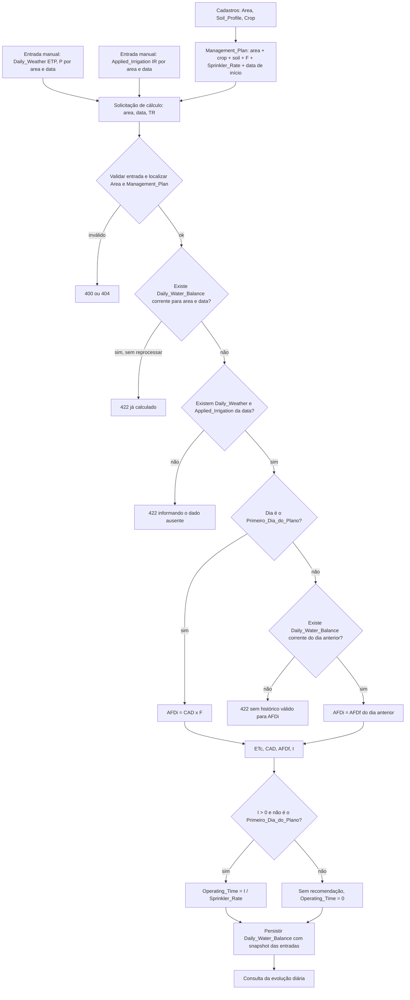

# Requirements Document

> Documento de Requisitos (conteúdo em pt-br; os títulos de seção exigidos pelo validador de formato ficam em inglês).

## Introduction

Este documento especifica o módulo **irrigation-water-balance-module**, que estende o backend existente (spec `irrigation-management-backend`, não alterada) com entrada de dados diários, balanço hídrico por área e cálculo do tempo de funcionamento do aspersor.

O módulo reaproveita os cadastros de Área, Solo e Cultura, o padrão de camadas (domínio, aplicação, infraestrutura, apresentação), o tratamento de erros em Problem_Details e o Flyway. As fórmulas deste documento foram fornecidas pelo usuário e são a única fonte de regras agronômicas. Nenhuma regra agronômica foi acrescentada. Onde o enunciado deixa uma lacuna, a lacuna está registrada na seção "Ambiguidades e Decisões Pendentes", com um padrão proposto e marcado como `[PADRÃO ADOTADO, PENDENTE]` nos requisitos que dependem dele.

Esta etapa produz somente a Spec para revisão. Nenhum código foi alterado.

## Glossary

- **Water_Balance_Module**: O conjunto de componentes deste módulo (planos de manejo, entradas diárias, cálculo e histórico).
- **Water_Balance_Service**: O serviço de aplicação que orquestra a sequência diária de cálculo, a persistência e o reprocessamento.
- **Water_Balance_Calculator**: O serviço de domínio puro (sem Spring ou JPA) que aplica as fórmulas deste documento.
- **Management_Plan**: Agregado novo que associa uma Area a um Crop e a um Soil_Profile e guarda os parâmetros de manejo F e Sprinkler_Rate, com data de início.
- **Daily_Weather**: Registro diário, por Area e data, com ETP e P informados manualmente.
- **Applied_Irrigation**: Registro diário, por Area e data, com a Irrigação Real (IR) efetivamente aplicada.
- **Daily_Water_Balance**: Registro imutável do cálculo de um dia para uma Area, com entradas usadas, resultados e controle.
- **Area**, **Crop**, **Soil_Profile**: Agregados já existentes.
- **Calculation_Engine**: Registry de metodologias já existente, hoje sem nenhuma metodologia registrada em produção.
- **Problem_Details**: Resposta de erro RFC 7807 já usada pela API.
- **ETP**: Evapotranspiração potencial diária, em mm. Informada manualmente.
- **P**: Precipitação diária, em mm. Informada manualmente.
- **IR**: Irrigação Real, lâmina em mm efetivamente aplicada no dia. Não é a recomendação.
- **KC**: Coeficiente de cultura, adimensional.
- **ETc**: Evapotranspiração da cultura, em mm, igual a KC multiplicado por ETP.
- **CC**: Capacidade de campo, em umidade gravimétrica, em porcentagem (%).
- **PMP**: Ponto de murcha permanente, em umidade gravimétrica, em porcentagem (%).
- **D**: Densidade aparente do solo, em g/cm³.
- **Z**: Profundidade radicular, em mm.
- **CAD**: Capacidade de água disponível, em mm.
- **F**: Fator de disponibilidade, decimal no intervalo (0, 1], por exemplo 0,50. Nunca dividido por 100.
- **TR**: Dia dentro do ciclo de rega, inteiro positivo (dia 1, 2, 3...). Ver DP-03.
- **Sprinkler_Rate**: Taxa de aplicação do aspersor, em mm/h.
- **AFDi**: Água facilmente disponível inicial do dia, em mm.
- **AFDf**: Água facilmente disponível final do dia, em mm.
- **I**: Irrigação Ideal do dia, em mm, igual a AFDi menos AFDf.
- **Operating_Time**: Tempo de funcionamento do aspersor, em horas, igual a I dividido por Sprinkler_Rate.
- **Primeiro_Dia_do_Plano**: A data de início do primeiro Management_Plan da Area (o plano de data de início mais antiga), primeiro dia do primeiro ciclo. Planos posteriores da mesma Area (por exemplo, após trocar Crop ou Soil_Profile) não têm Primeiro_Dia_do_Plano: continuam a cadeia, com AFDi igual à AFDf do dia anterior.
- **Reprocessamento**: Operação explícita que recalcula dias já calculados e gera novas revisões.

## Análise do Código Existente

### O que é reaproveitado

| Item existente | Uso neste módulo |
|---|---|
| `Area` (agregado, `areas`) | Âncora de todos os registros diários. Sem alteração estrutural, salvo relaxar campos opcionais (DP-08). |
| `Crop` / `CropStage` (`crops`, `crop_stages`) | Origem de KC e Z. `Crop` hoje não tem Z e só tem Kc por estágio (DP-05). |
| `SoilProfile` (`soil_profiles`) | Origem de CC, PMP e D. A densidade aparente (g/cm³, `BulkDensity`, máximo 3,00) é reaproveitada sem mudança. |
| `Recommendation` + `CalculationInput/Result` JSONB | Não reaproveitados para o balanço diário (DP-02 e DP-04). Permanecem intactos. |
| `CalculationEngine` / `CalculationMethod` | Não reaproveitados na primeira entrega (DP-02). Permanecem intactos e sem metodologia. |
| `ViolationCollector`, `ValidationFailedException`, `GlobalExceptionHandler`, `PageParams`, `Clock` | Reaproveitados como estão (validação 400 com `violations[]`, 404, 422, paginação, datas em UTC). |
| Mapeadores manuais de persistência, MapStruct na apresentação | Mesmo padrão para as novas entidades. |
| Migrações V1 a V3, trigger `set_updated_at()` | V1 a V3 não são editadas (checksum do Flyway). A função `set_updated_at()` é reutilizada nas tabelas novas. |

### Descompassos encontrados

1. **CC e PMP existentes são volumétricos.** `SoilProfile` guarda `field_capacity` e `permanent_wilting_point` como fração de 0,00 a 1,00 (`VolumetricWaterContent`, `NUMERIC(5,4)`, `chk_fc_range`), com `soil_water_unit = VOLUMETRIC_WATER_CONTENT`. A fórmula da CAD exige umidade gravimétrica em %. Os dois conceitos não são conversíveis sem dado adicional e não podem ser misturados.
2. **Área não tem vínculo com Solo nem Cultura.** Não existe chave estrangeira de `areas` para `soil_profiles` ou `crops`. A etapa "obter solo" e "obter cultura" da sequência diária não tem de onde ler (DP-01).
3. **Z está no solo, não na cultura.** `soil_profiles.effective_root_depth` (mm, obrigatório) existe. O enunciado coloca Z na cultura (DP-05).
4. **KC está por estágio, sem duração.** `crop_stages.kc` é obrigatório (`kc > 0` e `<= 2,0`), a cultura exige de 1 a 20 estágios e o estágio não tem duração em dias. Não há como escolher o estágio de uma data sem inventar regra (DP-05).
5. **Campos obrigatórios que não participam das fórmulas.** Em `soil_profiles`: `field_capacity`, `permanent_wilting_point`, `effective_root_depth`, as quatro colunas de unidade (`NOT NULL`, sem padrão desde a V2). Em `areas`: `area_ha`, `irrigation_system_type`, `system_flow_rate`. Em `crops`: pelo menos um estágio (regra de domínio, `Crop.validateStages`). O enunciado pede que só o indispensável seja obrigatório.
6. **O motor existente não comporta as fórmulas.** `CalculationInput` exige 12 campos (ETo, eficiência, área irrigada, vazão etc.) com limites próprios, e `CalculationResult` tem lâmina, volume e tempo, sem CAD ou AFD. `CalculationEngine.calculate` rejeita a entrada se qualquer campo estiver ausente. O Item em Aberto 1 da spec original (fórmulas) fica resolvido por este documento, mas o contrato do motor não foi desenhado para balanço com estado entre dias.
7. **`Area.systemFlowRate` (m³/h) e `irrigationEfficiency` são outra coisa.** A taxa do aspersor é lâmina por hora (mm/h). Reaproveitar `systemFlowRate` misturaria unidades. A eficiência não aparece em nenhuma fórmula do enunciado e não é usada.
8. **`Recommendation` guarda um instante (`date_time`) e não é única por dia.** Não serve para garantir "uma linha por área e data".
9. **Exclusões.** Área é bloqueada por 422 quando referenciada por recomendações. Solo e Cultura hoje não verificam referências, o que passa a ser necessário com o Management_Plan.
10. **Dados já gravados** (áreas, culturas, solos, recomendações) precisam sobreviver. Toda migração deste módulo é aditiva ou relaxa `NOT NULL`. Nenhuma coluna é removida ou convertida.

## Fluxo Completo: Entrada, Cálculo e Persistência



Sequência executada pelo Water_Balance_Service, na ordem do enunciado: identificar a Area; obter o Management_Plan e, por ele, o Soil_Profile e o Crop; obter F e Sprinkler_Rate; obter Daily_Weather da data; obter Applied_Irrigation da data; chamar o Water_Balance_Calculator (ETc, CAD, AFDi, AFDf, I, Operating_Time); persistir e disponibilizar para consulta.

---

# 1. Requisitos Funcionais

## Requirements

### Requisito 1: Cadastro de Solo com umidade gravimétrica e campos opcionais

**História de Usuário:** Como agrônomo, quero cadastrar um solo informando apenas CC, PMP e densidade, para que o solo possa ser usado no balanço hídrico sem preencher dados que as fórmulas não usam.

#### Critérios de Aceitação

1. A entidade Soil_Profile DEVE armazenar CC e PMP gravimétricos como porcentagem de massa de água sobre massa de solo seco, em campos distintos dos campos volumétricos existentes
2. O Soil_Service DEVE aceitar CC e PMP gravimétricos somente quando ambos estiverem no intervalo de 0 a 100, inclusive, e CC for estritamente maior que PMP
3. O Soil_Service DEVE aceitar D somente quando for maior que zero e menor ou igual a 3,00 g/cm³, mantendo a regra existente de `BulkDensity`
4. QUANDO uma requisição de criação de solo contiver apenas tipo de solo, CC gravimétrico, PMP gravimétrico e D, e todos os valores forem válidos, O Soil_Service DEVE persistir o solo e retornar HTTP 201
5. QUANDO uma requisição de atualização de solo existente contiver apenas tipo de solo, CC gravimétrico, PMP gravimétrico e D, e todos os valores forem válidos, O Soil_Service DEVE persistir a alteração e retornar HTTP 200
6. A entidade Soil_Profile DEVE tratar como opcionais a capacidade de campo volumétrica, o ponto de murcha permanente volumétrico, a profundidade efetiva de raízes, a água disponível e as quatro unidades associadas
7. ONDE a capacidade de campo volumétrica e o ponto de murcha permanente volumétrico forem informados juntos, O Soil_Service DEVE manter a validação existente de que a capacidade de campo é maior que o ponto de murcha permanente
8. SE apenas um dos dois valores volumétricos for informado, ENTÃO O Soil_Service DEVE retornar HTTP 400 com Problem_Details indicando o par incompleto e não persistir nenhuma alteração
9. SE CC ou PMP gravimétrico estiver fora do intervalo de 0 a 100, ou CC não for maior que PMP, ou D estiver fora do intervalo de 0 (exclusivo) a 3,00 g/cm³, ENTÃO O Soil_Service DEVE retornar HTTP 400 com Problem_Details que liste cada campo inválido e não persistir nenhuma alteração
10. A API de solo DEVE aceitar e devolver todos os campos que já existiam antes deste módulo, com os mesmos nomes, tipos e significados, de modo que uma requisição válida de um cliente existente receba a mesma resposta de sucesso que recebia antes
11. QUANDO um solo existente anterior a este módulo for lido, O Soil_Service DEVE devolver CC e PMP gravimétricos nulos e preservar todos os valores existentes sem alteração
12. SE o solo de um Management_Plan não tiver CC gravimétrico, PMP gravimétrico ou D, ENTÃO O Water_Balance_Service DEVE recusar o cálculo conforme o Requisito 11, sem gravar resultado
13. SE uma requisição de exclusão de solo referenciado por um Management_Plan for recebida, ENTÃO O Soil_Service DEVE retornar HTTP 422 com Problem_Details e manter o solo inalterado

### Requisito 2: Cadastro de Cultura com KC e Z e estágios opcionais

**História de Usuário:** Como agrônomo, quero cadastrar uma cultura informando apenas KC e Z, para que a cultura possa ser usada no balanço hídrico.

#### Critérios de Aceitação

1. `[PADRÃO ADOTADO, PENDENTE: DP-05]` A entidade Crop DEVE armazenar KC e Z como campos próprios da cultura
2. O Crop_Service DEVE aceitar KC somente quando for maior que 0 (exclusivo) e menor ou igual a 2,0 (inclusivo), mantendo o limite existente de `Kc`
3. O Crop_Service DEVE aceitar Z somente quando for maior que 0 mm (exclusivo) e menor ou igual a 5.000,00 mm (inclusivo), mantendo o limite existente de `RootDepth`
4. QUANDO uma requisição de criação ou atualização de cultura contiver apenas nome, KC e Z válidos, O Crop_Service DEVE persistir a cultura com zero Crop_Stage e devolver a cultura persistida contendo os valores informados
5. A entidade Crop DEVE aceitar de 0 a 20 Crop_Stage, deixando de exigir pelo menos um
6. A API de cultura DEVE continuar aceitando e devolvendo estágios, variedade e ciclo de cultivo
7. QUANDO uma cultura existente anterior a este módulo for lida, O Crop_Service DEVE devolver KC e Z nulos e preservar estágios, variedade e ciclo sem alteração de valores
8. SE a cultura de um Management_Plan não tiver KC ou Z, ENTÃO O Water_Balance_Service DEVE recusar o cálculo conforme o Requisito 11, sem persistir resultado
9. SE uma requisição de exclusão de cultura referenciada por um Management_Plan for recebida, ENTÃO O Crop_Service DEVE retornar HTTP 422 com Problem_Details e manter a cultura inalterada
10. SE uma requisição de criação ou atualização de cultura omitir KC ou Z, ou informar KC ou Z fora da faixa dos critérios 2 e 3, ENTÃO O Crop_Service DEVE recusar a requisição com Problem_Details que identifique cada campo inválido e DEVE manter inalterado o estado persistido
11. SE uma requisição de criação ou atualização de cultura contiver mais de 20 Crop_Stage, ENTÃO O Crop_Service DEVE recusar a requisição com Problem_Details que identifique o campo de estágios e DEVE manter inalterado o estado persistido

### Requisito 3: Cadastro de Área com campos opcionais

**História de Usuário:** Como agrônomo, quero cadastrar uma área informando somente o nome, para que dados que as fórmulas não usam não bloqueiem o manejo.

#### Critérios de Aceitação

1. `[PADRÃO ADOTADO, PENDENTE: DP-08]` QUANDO uma requisição de criação ou atualização de área for recebida sem área em hectares, sem tipo de sistema de irrigação ou sem vazão do sistema, O Area_Service DEVE aceitar a requisição e armazenar cada campo omitido como ausente, mantendo o nome como único campo obrigatório (não vazio, não em branco e com no máximo 255 caracteres)
2. ONDE a área em hectares for informada, O Area_Service DEVE validar que ela seja maior que zero e no máximo 1.000.000,00, e ONDE a vazão do sistema for informada, O Area_Service DEVE validar que ela seja maior que zero e no máximo 1.000.000,00
3. SE a área em hectares ou a vazão do sistema informada estiver fora do intervalo válido, ENTÃO O Area_Service DEVE retornar HTTP 400 Bad Request com uma resposta Problem_Details que identifique o campo inválido, sem criar nem alterar a área
4. QUANDO uma área existente anterior a este módulo for lida, O Area_Service DEVE retornar todos os valores de nome, área em hectares, localização geográfica, características gerais, tipo de sistema de irrigação e vazão do sistema idênticos aos armazenados antes da introdução deste módulo
5. SE uma requisição de exclusão de área referenciada por ao menos um registro de Daily_Water_Balance, Daily_Weather, Applied_Irrigation, Management_Plan ou recomendação for recebida, ENTÃO O Area_Service DEVE retornar HTTP 422 Unprocessable Entity com uma resposta Problem_Details e manter a área e todos os registros que a referenciam inalterados

### Requisito 4: Plano de Manejo

**História de Usuário:** Como agrônomo, quero associar uma área a um solo e a uma cultura e informar F e a taxa do aspersor, para que o sistema saiba quais parâmetros usar no balanço diário.

#### Critérios de Aceitação

1. `[PADRÃO ADOTADO, PENDENTE: DP-01]` O Water_Balance_Module DEVE persistir o Management_Plan com a Area, o Crop, o Soil_Profile, a data de início, F e Sprinkler_Rate
2. QUANDO uma requisição válida de criação de Management_Plan for recebida, O Water_Balance_Module DEVE persistir o plano sem data de término e retornar HTTP 201 com o plano criado
3. SE F for menor ou igual a zero, maior que 1 ou tiver mais de 4 casas decimais, ENTÃO O Water_Balance_Module DEVE rejeitar a requisição com HTTP 400 e Problem_Details identificando o campo F, sem persistir o plano. Valores como 0,50 DEVEM ser aceitos como informados, sem divisão por 100
4. SE Sprinkler_Rate for menor ou igual a zero ou maior que 500 mm/h, ENTÃO O Water_Balance_Module DEVE rejeitar a requisição com HTTP 400 e Problem_Details identificando o campo Sprinkler_Rate, sem persistir o plano. O valor DEVE ser interpretado em mm/h
5. SE a data de início, o identificador da Area, o do Crop ou o do Soil_Profile estiver ausente, ou se a data de início não for uma data de calendário válida, ENTÃO O Water_Balance_Module DEVE rejeitar a requisição com HTTP 400 e Problem_Details listando todos os campos inválidos, sem persistir o plano
6. SE a Area, o Crop ou o Soil_Profile informado não existir, ENTÃO O Water_Balance_Module DEVE retornar HTTP 404 com Problem_Details identificando qual recurso não foi encontrado, sem persistir o plano
7. A Area DEVE ter no máximo um Management_Plan ativo, isto é, sem data de término
8. SE uma requisição criar um segundo Management_Plan ativo para a mesma Area, ENTÃO O Water_Balance_Module DEVE retornar HTTP 422 com Problem_Details e manter inalterado o plano ativo existente. Se duas requisições de criação para a mesma Area forem processadas simultaneamente, no máximo uma DEVE retornar HTTP 201
9. QUANDO F ou Sprinkler_Rate de um Management_Plan for atualizado, O Water_Balance_Module DEVE aplicar o novo valor somente aos cálculos iniciados depois da confirmação da atualização, mantendo inalterados os Daily_Water_Balance já persistidos
10. `[PADRÃO ADOTADO, PENDENTE: DP-06]` SE uma requisição tentar trocar o Crop ou o Soil_Profile de um Management_Plan que já tenha pelo menos um Daily_Water_Balance, ENTÃO O Water_Balance_Module DEVE retornar HTTP 422 com Problem_Details orientando a encerrar o plano e criar outro, mantendo o plano inalterado
11. QUANDO uma requisição de consulta de Management_Plan por Area existente for recebida, O Water_Balance_Module DEVE retornar HTTP 200 com o plano ativo e os planos encerrados, ordenados por data de início decrescente. Se a Area não tiver planos, a lista retornada DEVE ser vazia
12. SE uma requisição de consulta de Management_Plan referenciar uma Area inexistente, ENTÃO O Water_Balance_Module DEVE retornar HTTP 404 com Problem_Details
### Requisito 5: Entrada manual de meteorologia diária

**História de Usuário:** Como agrônomo, quero informar ETP e P de cada dia da área, para que o balanço hídrico use dados do meu campo.

#### Critérios de Aceitação

1. QUANDO uma requisição válida de registro de Daily_Weather para uma Area existente for recebida, O Water_Balance_Module DEVE persistir ETP e P para a Area e a data e retornar o registro persistido
2. O Water_Balance_Module DEVE exigir ETP e P numéricos, não nulos, no intervalo de 0 a 1.000 mm inclusive, com no máximo 2 casas decimais, e uma data no formato ISO 8601 (AAAA-MM-DD) que não seja posterior à data atual em UTC
3. QUANDO não houve chuva no dia, O Water_Balance_Module DEVE exigir P igual a 0 informado explicitamente
4. SE a requisição omitir ETP, P ou a data, ENTÃO O Water_Balance_Module DEVE retornar HTTP 400 com Problem_Details indicando cada campo ausente, sem persistir nenhum registro
5. SE ETP ou P estiver fora do intervalo de 0 a 1.000 mm, tiver mais de 2 casas decimais, não for numérico, ou se a data for inválida ou posterior à data atual em UTC, ENTÃO O Water_Balance_Module DEVE retornar HTTP 400 com Problem_Details indicando cada campo inválido, sem persistir nenhum registro
6. SE a Area informada não existir, ENTÃO O Water_Balance_Module DEVE retornar HTTP 404 com Problem_Details e não persistir nenhum registro
7. SE já existir Daily_Weather para a Area e a data, ENTÃO O Water_Balance_Module DEVE substituir os valores de ETP e P, mantendo uma única linha por Area e data
8. QUANDO um Daily_Weather for substituído depois de a data já ter sido calculada, O Water_Balance_Module DEVE manter o Daily_Water_Balance anterior inalterado até um Reprocessamento, e QUANDO o Reprocessamento da data for concluído, O Water_Balance_Module DEVE gerar uma nova revisão corrente calculada com os valores substituídos
9. QUANDO uma requisição de consulta de Daily_Weather por Area e período for recebida, O Water_Balance_Module DEVE retornar os registros com data entre o início e o fim do período, ambos inclusive, em ordem cronológica crescente, e uma lista vazia se não houver registros
10. SE o período de consulta tiver data inicial posterior à final, data inválida ou mais de 366 dias, ENTÃO O Water_Balance_Module DEVE retornar HTTP 400 com Problem_Details indicando o parâmetro inválido
11. SE a Area informada em uma consulta de Daily_Weather por período não existir, ENTÃO O Water_Balance_Module DEVE retornar HTTP 404 com Problem_Details, e NÃO DEVE retornar HTTP 200 com lista vazia
12. O Water_Balance_Module DEVE aceitar somente entrada manual nesta versão, sem integração com serviços meteorológicos externos

### Requisito 6: Entrada da Irrigação Real

**História de Usuário:** Como agrônomo, quero informar a lâmina realmente aplicada a cada dia, para que o balanço considere o que de fato foi irrigado e não o que foi recomendado.

#### Critérios de Aceitação

1. QUANDO uma requisição válida de registro de Applied_Irrigation for recebida, O Water_Balance_Module DEVE persistir IR para a Area e a data informadas e confirmar o registro ao solicitante com os valores persistidos (Area, data e IR)
2. SE a requisição de registro de Applied_Irrigation tiver IR ausente, nula, negativa, não numérica ou maior que 1.000 mm, ENTÃO O Water_Balance_Module DEVE rejeitar a requisição indicando o campo IR inválido, sem persistir nem alterar nenhum registro
3. O Water_Balance_Module DEVE aceitar IR com valor de 0 a 1.000 mm, inclusive, com até 2 casas decimais
4. QUANDO não houve irrigação no dia, O Water_Balance_Module DEVE exigir IR igual a zero informado explicitamente, e SE o IR for omitido, ENTÃO O Water_Balance_Module DEVE rejeitar a requisição sem assumir zero
5. SE a requisição de registro de Applied_Irrigation referenciar uma Area inexistente, ENTÃO O Water_Balance_Module DEVE rejeitar a requisição indicando que a Area não foi encontrada, sem persistir nenhum registro
6. SE a data da requisição de registro de Applied_Irrigation estiver ausente, tiver formato inválido ou for posterior à data atual em UTC, ENTÃO O Water_Balance_Module DEVE rejeitar a requisição indicando o campo de data inválido, sem persistir nenhum registro
7. SE já existir Applied_Irrigation para a Area e a data, ENTÃO O Water_Balance_Module DEVE substituir o valor de IR, mantendo uma única linha por Area e data, inclusive quando duas requisições para a mesma Area e data forem recebidas simultaneamente
8. O Water_Balance_Module DEVE manter IR e Irrigação Ideal em campos distintos, sem preencher IR com a recomendação, e DEVE retornar IR igual a nulo ou inexistente para datas sem registro de Applied_Irrigation
9. QUANDO um Applied_Irrigation for substituído depois de a data já ter sido calculada, O Water_Balance_Module DEVE manter o Daily_Water_Balance anterior inalterado até um Reprocessamento, e QUANDO o Reprocessamento da data for concluído, O Water_Balance_Module DEVE gerar uma nova revisão corrente calculada com o valor de IR substituído, de modo que o resultado deixe de ser o do cálculo anterior
10. QUANDO uma requisição de consulta de Applied_Irrigation por Area e período for recebida, O Water_Balance_Module DEVE retornar os registros do período, inclusive nas datas de início e fim, em ordem cronológica crescente
11. SE a consulta de Applied_Irrigation tiver data de início posterior à data de fim, data com formato inválido ou Area inexistente, ENTÃO O Water_Balance_Module DEVE rejeitar a requisição indicando o parâmetro inválido ou a Area não encontrada, sem retornar registros
12. QUANDO a consulta de Applied_Irrigation não encontrar registros no período para uma Area existente, O Water_Balance_Module DEVE retornar uma lista vazia como resultado bem-sucedido

### Requisito 7: Cálculo diário do balanço hídrico

**História de Usuário:** Como agrônomo, quero calcular o balanço de um dia da área, para saber a necessidade de irrigação e o tempo de funcionamento do aspersor.

#### Critérios de Aceitação

1. QUANDO uma requisição de cálculo com Area, data e TR for recebida e válida, O Water_Balance_Service DEVE executar a sequência: obter Management_Plan, Soil_Profile, Crop, F, Sprinkler_Rate, Daily_Weather e Applied_Irrigation do dia, depois calcular ETc, CAD, AFDi, AFDf, I e Operating_Time
2. QUANDO o cálculo for concluído, O Water_Balance_Service DEVE persistir o resultado em um Daily_Water_Balance conforme o Requisito 12, de forma que, se a persistência falhar, nenhum Daily_Water_Balance parcial do dia seja mantido
3. QUANDO o cálculo for concluído, O Water_Balance_Service DEVE retornar HTTP 201 com entradas usadas, resultados e controle
4. SE a requisição tiver TR que não seja inteiro positivo, data ausente ou fora do formato de data ISO 8601, ou data anterior ao início do Management_Plan, ENTÃO O Water_Balance_Service DEVE rejeitar a requisição com HTTP 400 e Problem_Details que indique cada campo inválido, sem persistir Daily_Water_Balance. O limite superior de TR depende de DP-03
5. SE a Area não existir, ENTÃO O Water_Balance_Service DEVE retornar HTTP 404 com Problem_Details
6. SE a Area não tiver Management_Plan ativo na data, ENTÃO O Water_Balance_Service DEVE retornar HTTP 422 com Problem_Details, sem persistir Daily_Water_Balance
7. SE não existir Daily_Weather da Area para a data solicitada, ENTÃO O Water_Balance_Service DEVE retornar HTTP 422 com Problem_Details que identifique a entrada ausente, sem persistir Daily_Water_Balance
8. SE existir algum dia entre o início do Management_Plan e o dia anterior à data solicitada sem Daily_Water_Balance, ENTÃO O Water_Balance_Service DEVE retornar HTTP 422 com Problem_Details que informe a primeira data sem cálculo, sem persistir Daily_Water_Balance
9. O Water_Balance_Service DEVE usar o Water_Balance_Calculator para todas as fórmulas, sem cálculo na camada de apresentação ou de persistência
10. O Water_Balance_Calculator DEVE ser independente de Spring e JPA, de modo que as regras de ArchUnit existentes continuem válidas

### Requisito 8: Continuidade da AFDi entre dias e ciclos

**História de Usuário:** Como agrônomo, quero que o balanço continue de um dia para o outro, inclusive quando um novo ciclo de rega começa, para que o saldo de água do solo reflita o histórico real.

#### Critérios de Aceitação

1. QUANDO a data calculada for o Primeiro_Dia_do_Plano, O Water_Balance_Calculator DEVE definir AFDi igual a CAD multiplicada por F, usando os valores de CAD e F vigentes nessa data
2. QUANDO a data calculada for posterior ao Primeiro_Dia_do_Plano e existir Daily_Water_Balance corrente do dia imediatamente anterior, O Water_Balance_Calculator DEVE definir AFDi igual, sem arredondamento adicional, à AFDf desse Daily_Water_Balance
3. QUANDO TR voltar a 1 em um novo ciclo, O Water_Balance_Calculator DEVE manter AFDi igual à AFDf do dia anterior, sem reaplicar CAD multiplicada por F
4. SE a data calculada for posterior ao Primeiro_Dia_do_Plano e não existir Daily_Water_Balance corrente do dia imediatamente anterior, ENTÃO O Water_Balance_Service DEVE retornar HTTP 422 com Problem_Details informando a data sem histórico, NÃO DEVE calcular com valor arbitrário e NÃO DEVE gravar nenhum Daily_Water_Balance para a data solicitada
5. SE a AFDf calculada for maior que CAD, ENTÃO O Water_Balance_Calculator DEVE manter o valor calculado, sem limitar nem truncar, e DEVE usá-lo como AFDi do dia seguinte
6. SE a AFDf calculada for negativa, ENTÃO O Water_Balance_Calculator DEVE manter o valor negativo, sem limitar nem truncar, e DEVE usá-lo como AFDi do dia seguinte `[PADRÃO ADOTADO, PENDENTE: DP-10]`

### Requisito 9: Irrigação Ideal e restrição de início

**História de Usuário:** Como agrônomo, quero ver quanto irrigar em cada dia e que o sistema não recomende irrigação no primeiro dia do primeiro ciclo.

#### Critérios de Aceitação

1. QUANDO o Water_Balance_Calculator processar um dia, O Water_Balance_Calculator DEVE calcular I como AFDi menos AFDf, usando as mesmas unidades de AFDi e AFDf e preservando o sinal do resultado, inclusive quando I for negativo
2. SE I for maior que zero e a data não for o Primeiro_Dia_do_Plano, ENTÃO O Water_Balance_Service DEVE marcar o dia como recomendado
3. SE I for menor ou igual a zero, ENTÃO O Water_Balance_Service DEVE marcar o dia como não recomendado, definir Operating_Time igual a zero e não registrar o motivo `FIRST_DAY_OF_FIRST_CYCLE`
4. SE a data for o Primeiro_Dia_do_Plano, ENTÃO O Water_Balance_Service DEVE marcar o dia como não recomendado, definir Operating_Time igual a zero e registrar o motivo `FIRST_DAY_OF_FIRST_CYCLE`, independentemente de I ser maior, igual ou menor que zero, preservando o valor calculado de I no registro sem alteração
5. O Water_Balance_Service DEVE manter I e IR em campos distintos no registro e na resposta, sem que o valor de um substitua ou altere o valor do outro
6. SE a data for o segundo dia do primeiro ciclo (Primeiro_Dia_do_Plano mais um dia) e I for maior que zero, ENTÃO O Water_Balance_Service DEVE marcar o dia como recomendado, sem registrar o motivo `FIRST_DAY_OF_FIRST_CYCLE`
### Requisito 10: Tempo de funcionamento

**História de Usuário:** Como operador, quero saber por quanto tempo ligar o aspersor, em horas e em horas e minutos.

#### Critérios de Aceitação

1. QUANDO o dia for recomendado e Sprinkler_Rate for maior que zero, O Water_Balance_Calculator DEVE calcular Operating_Time em horas decimais como I dividida por Sprinkler_Rate, com I em mm e Sprinkler_Rate em mm/h, conforme a escala e o arredondamento do Requisito 15
2. QUANDO o dia não for recomendado, O Water_Balance_Calculator DEVE definir Operating_Time igual a 0 hora, 0 hora inteira e 0 minuto inteiro
3. QUANDO o Water_Balance_Service disponibilizar Operating_Time, O Water_Balance_Service DEVE retornar o valor em horas decimais e também em horas inteiras e minutos inteiros, com horas inteiras maiores ou iguais a 0 e minutos inteiros entre 0 e 59, de modo que horas inteiras × 60 + minutos inteiros seja igual a Operating_Time em horas decimais × 60 arredondado ao minuto inteiro mais próximo
4. SE Sprinkler_Rate for menor ou igual a zero, ENTÃO O Water_Balance_Service DEVE impedir o cálculo do tempo, rejeitar a requisição com erro de regra de negócio (HTTP 422) acompanhado de Problem_Details informando que Sprinkler_Rate deve ser maior que zero, e NÃO DEVE persistir resultado
5. SE Sprinkler_Rate estiver ausente ou não for numérico, ENTÃO O Water_Balance_Service DEVE rejeitar a requisição com erro de validação (HTTP 400) acompanhado de Problem_Details que identifique o campo Sprinkler_Rate, e NÃO DEVE persistir resultado
6. A API DEVE identificar Sprinkler_Rate sempre com a unidade mm/h

### Requisito 11: Pré-condições e situações especiais

**História de Usuário:** Como agrônomo, quero mensagens claras quando faltar dado, para corrigir a entrada sem receber cálculo com valores inventados.

#### Critérios de Aceitação

1. SE a Area existir e não houver nenhum registro de Daily_Weather da Area para a data solicitada, ENTÃO O Water_Balance_Service DEVE retornar HTTP 422 com Problem_Details contendo mensagem de ausência de meteorologia e a data consultada, NÃO DEVE calcular o dia e NÃO DEVE gravar nenhum registro de balanço hídrico
2. SE a Area existir e não houver nenhum registro de Applied_Irrigation da Area para a data solicitada, ENTÃO O Water_Balance_Service DEVE retornar HTTP 422 com Problem_Details contendo mensagem de ausência de Irrigação Real e a data consultada, NÃO DEVE calcular o dia e NÃO DEVE gravar nenhum registro de balanço hídrico. Um registro de Applied_Irrigation com lâmina igual a zero DEVE ser tratado como presente
3. SE o Soil_Profile do plano não tiver valor informado para CC gravimétrico, PMP gravimétrico ou D, ENTÃO O Water_Balance_Service DEVE retornar HTTP 422 com Problem_Details listando o nome de cada um desses campos ausentes, NÃO DEVE calcular o dia e NÃO DEVE gravar nenhum registro de balanço hídrico
4. SE o Crop do plano não tiver valor informado para KC ou Z, ENTÃO O Water_Balance_Service DEVE retornar HTTP 422 com Problem_Details listando o nome de cada um desses campos ausentes, NÃO DEVE calcular o dia e NÃO DEVE gravar nenhum registro de balanço hídrico
5. SE duas ou mais pré-condições dos critérios 1 a 4 falharem na mesma solicitação, ENTÃO O Water_Balance_Service DEVE retornar uma única resposta HTTP 422 com Problem_Details contendo uma entrada para cada pré-condição não atendida, sem omitir nenhuma e sem repetir a mesma entrada
6. O Water_Balance_Service DEVE aplicar a seguinte ordem de verificação, interrompendo na primeira etapa que falhar: (1) validação de formato, com HTTP 400; (2) existência da Area, com HTTP 404; (3) pré-condições dos critérios 1 a 4, com HTTP 422
7. SE um cálculo for solicitado para uma Area e uma data que já possuem registro corrente de balanço hídrico e a solicitação não indicar Reprocessamento explicitamente, ENTÃO O Water_Balance_Service DEVE retornar HTTP 422 com Problem_Details informando que a data já foi calculada, DEVE manter inalterado o registro corrente existente e NÃO DEVE criar segundo registro corrente para a mesma Area e data
8. SE a data solicitada tiver formato inválido, ENTÃO O Water_Balance_Service DEVE retornar HTTP 400 com Problem_Details identificando o campo de data inválido, sem consultar a existência da Area nem as pré-condições

### Requisito 12: Persistência e histórico

**História de Usuário:** Como agrônomo, quero que cada cálculo guarde os valores usados na data, para que mudanças futuras nos cadastros não alterem o passado.

#### Critérios de Aceitação

1. QUANDO um cálculo do Daily_Water_Balance for concluído com sucesso, O Water_Balance_Service DEVE persistir, em uma única operação atômica, a identificação do cálculo: Area, data (dia civil), Crop, Soil_Profile, Management_Plan e TR
2. QUANDO um cálculo do Daily_Water_Balance for concluído com sucesso, O Water_Balance_Service DEVE persistir, na mesma operação atômica, as entradas usadas: ETP, P, IR, CC, PMP, D, Z, KC, F e Sprinkler_Rate, com os valores que estavam em vigor no momento do cálculo
3. QUANDO um cálculo do Daily_Water_Balance for concluído com sucesso, O Water_Balance_Service DEVE persistir, na mesma operação atômica, os resultados: ETc, CAD, AFDi, AFDf, Irrigação Ideal, indicador de recomendação (verdadeiro ou falso), motivo de não recomendação e Operating_Time em horas
4. QUANDO um cálculo do Daily_Water_Balance for concluído com sucesso, O Water_Balance_Service DEVE persistir, na mesma operação atômica, o controle: data e hora da execução em UTC, identificador e versão da metodologia e número da revisão
5. SE a persistência de qualquer grupo de dados do cálculo (identificação, entradas, resultados ou controle) falhar, ENTÃO O Water_Balance_Service DEVE desfazer a gravação completa do cálculo, não deixar registro parcial e retornar um erro ao chamador indicando falha de persistência
6. QUANDO um cadastro de Solo, Cultura, Área ou Management_Plan for alterado, O Water_Balance_Module DEVE manter inalterados os valores de entrada e resultado dos Daily_Water_Balance já gravados, de modo que a leitura de um registro após a alteração retorne valores idênticos aos lidos antes dela
7. O Water_Balance_Module DEVE tratar o Daily_Water_Balance como imutável: nenhuma operação do sistema altera uma linha gravada, exceto a marcação de revisão não corrente prevista no Requisito 13
8. SE uma operação tentar alterar ou excluir um Daily_Water_Balance já gravado, ENTÃO O Water_Balance_Module DEVE rejeitar a operação, manter a linha inalterada e retornar um erro indicando que o registro é imutável
9. O Water_Balance_Module DEVE garantir, no banco, no máximo um Daily_Water_Balance corrente por Area e data, inclusive sob requisições concorrentes para a mesma Area e data
10. SE uma gravação violar a unicidade de Daily_Water_Balance corrente por Area e data, ENTÃO O Water_Balance_Module DEVE rejeitar a gravação, manter o registro corrente existente inalterado e retornar um erro indicando conflito
11. O Water_Balance_Module DEVE persistir os valores numéricos sem arredondamento intermediário (Requisito 15), de modo que o valor lido do banco seja numericamente igual ao valor calculado, sem perda de casas decimais
### Requisito 13: Reprocessamento explícito

**História de Usuário:** Como agrônomo, quero corrigir um dado de um dia passado e recalcular a partir dele, para que a evolução do balanço volte a ficar coerente.

#### Critérios de Aceitação

1. `[PADRÃO ADOTADO, PENDENTE: DP-07]` QUANDO uma requisição explícita de Reprocessamento com Area e data inicial for recebida, O Water_Balance_Service DEVE recalcular, em ordem cronológica crescente, a data inicial e todas as datas posteriores da mesma Area que já possuam revisão corrente, sem calcular datas que nunca foram calculadas
2. QUANDO um dia for reprocessado, O Water_Balance_Service DEVE criar exatamente uma nova revisão corrente para esse dia, com número de revisão igual ao da revisão anterior acrescido de 1, e marcar a revisão anterior como não corrente, sem apagá-la nem alterar seus valores, de modo que cada dia tenha exatamente uma revisão corrente ao fim da operação
3. QUANDO um Reprocessamento começar em data posterior ao Primeiro_Dia_do_Plano, O Water_Balance_Service DEVE obter AFDi da revisão corrente do dia imediatamente anterior à data inicial; e, para cada dia seguinte reprocessado, DEVE obter AFDi da nova revisão corrente do dia anterior criada na mesma operação
4. SE qualquer dia do Reprocessamento violar uma pré-condição do Requisito 11, ENTÃO O Water_Balance_Service DEVE interromper a operação, não criar nenhuma nova revisão, manter inalteradas todas as revisões correntes e retornar HTTP 422 com Problem_Details que identifique a data que violou a pré-condição
5. O Water_Balance_Service DEVE executar o Reprocessamento em uma única transação, de modo que uma consulta concorrente veja o estado anterior completo ou o estado posterior completo, nunca um estado parcial
6. QUANDO uma consulta de histórico for feita, O Water_Balance_Service DEVE retornar por padrão somente as revisões correntes e DEVE permitir consultar todas as revisões de uma data, em ordem decrescente de número de revisão. QUANDO a consulta de histórico não especificar data, O Water_Balance_Service DEVE retornar as revisões correntes de todas as datas da Area, em ordem cronológica crescente
7. SE a data inicial do Reprocessamento não possuir revisão corrente para a Area informada, ENTÃO O Water_Balance_Service DEVE rejeitar a requisição sem criar nenhuma revisão e retornar HTTP 422 com Problem_Details indicando que a data não foi calculada
8. SE já houver um Reprocessamento em andamento para a mesma Area, ENTÃO O Water_Balance_Service DEVE rejeitar a nova requisição sem criar nenhuma revisão e retornar HTTP 409 com Problem_Details indicando conflito

### Requisito 14: Consulta da evolução diária

**História de Usuário:** Como agrônomo, quero consultar a evolução diária do balanço, para acompanhar o manejo.

#### Critérios de Aceitação

1. QUANDO uma requisição de consulta por Area e período for recebida e a Area existir, O Water_Balance_Service DEVE retornar HTTP 200 com os Daily_Water_Balance correntes cuja data esteja entre a data inicial e a data final, ambas inclusivas, em ordem cronológica crescente, com paginação usando os padrões existentes (página 0, tamanho 20, máximo 100)
2. QUANDO uma requisição de consulta por Area e data for recebida e existir cálculo, O Water_Balance_Service DEVE retornar HTTP 200 com as entradas, os resultados e o controle do Daily_Water_Balance daquela data
3. QUANDO uma requisição de consulta por Area e data for recebida e não existir cálculo para aquela data, O Water_Balance_Service DEVE retornar HTTP 404 com Problem_Details
4. SE o período tiver data inicial posterior à data final, ENTÃO O Water_Balance_Service DEVE retornar HTTP 400 com Problem_Details indicando as datas inválidas, sem retornar nenhum registro
5. QUANDO não houver registros no período e a Area existir, O Water_Balance_Service DEVE retornar HTTP 200 com página vazia, com total de elementos igual a 0
6. O Water_Balance_Service DEVE retornar cada valor em mm com a política de apresentação do Requisito 15
7. SE a Area informada em uma consulta por período ou por data não existir, ENTÃO O Water_Balance_Service DEVE retornar HTTP 404 com Problem_Details, sem retornar página vazia
8. SE uma consulta tiver data em formato inválido, página negativa, tamanho menor que 1 ou tamanho maior que 100, ENTÃO O Water_Balance_Service DEVE retornar HTTP 400 com Problem_Details identificando o campo inválido, sem ajustar o valor automaticamente

### Requisito 15: Precisão e arredondamento

**História de Usuário:** Como agrônomo, quero resultados consistentes e rastreáveis, para que o mesmo dado sempre produza o mesmo número.

#### Critérios de Aceitação

1. O Water_Balance_Calculator DEVE usar `BigDecimal` em todas as operações, sem `double` ou `float`
2. O Water_Balance_Calculator DEVE manter ETc, CAD, AFDi, AFDf e I sem arredondamento, pois a multiplicação e a soma em `BigDecimal` são exatas, de modo que o valor persistido seja idêntico ao valor calculado
3. `[PADRÃO ADOTADO, PENDENTE: DP-09]` O Water_Balance_Calculator DEVE calcular a divisão de Operating_Time com 10 casas decimais, arredondamento HALF_EVEN, e DEVE persistir o resultado com essa escala
4. `[PADRÃO ADOTADO, PENDENTE: DP-09]` QUANDO uma resposta da API apresentar valores em mm, O Water_Balance_Service DEVE arredondar para 2 casas decimais com HALF_UP somente na apresentação (HALF_UP arredonda metades para longe do zero, inclusive para valores negativos)
5. `[PADRÃO ADOTADO, PENDENTE: DP-09]` QUANDO uma resposta da API apresentar Operating_Time em horas, O Water_Balance_Service DEVE arredondar para 4 casas decimais com HALF_UP somente na apresentação
6. `[PADRÃO ADOTADO, PENDENTE: DP-09]` QUANDO uma resposta apresentar horas e minutos, O Water_Balance_Service DEVE calcular o total de minutos como Operating_Time multiplicado por 60, arredondar para minutos inteiros com HALF_UP e distribuir em horas inteiras e minutos de 0 a 59
7. O Water_Balance_Service DEVE aplicar, em todas as respostas do módulo, as mesmas escalas e o mesmo modo de arredondamento definidos nos critérios 4, 5 e 6 (mm com 2 casas, horas com 4 casas, minutos inteiros), sem variação entre endpoints
8. QUANDO um cálculo posterior usar um resultado já calculado, O Water_Balance_Service DEVE usar o valor persistido sem arredondamento, e não o valor apresentado
9. QUANDO o Water_Balance_Calculator receber os mesmos dados de entrada e a mesma metodologia mais de uma vez, O Water_Balance_Calculator DEVE produzir resultados numericamente idênticos, com os mesmos valores e as mesmas escalas, em todas as execuções
10. SE o divisor da divisão de Operating_Time for igual a zero, ENTÃO O Water_Balance_Calculator DEVE rejeitar o cálculo com erro indicando divisor inválido, sem produzir resultado e sem persistir dados, e, quando o cálculo fizer parte de um Reprocessamento, O Water_Balance_Service DEVE abortar a operação inteira conforme o Requisito 13, critério 4. Esse caso não deve ocorrer, porque Sprinkler_Rate maior que zero é validado antes

### Requisito 16: Preservação das funcionalidades existentes

**História de Usuário:** Como mantenedor, quero que o módulo novo não quebre o que já funciona.

#### Critérios de Aceitação

1. O Water_Balance_Module DEVE manter os endpoints existentes de áreas, solos, culturas, recomendações e saúde com os mesmos caminhos, métodos, campos de requisição e de resposta (nomes, tipos e obrigatoriedade), códigos de status e formato de erro que possuíam antes da introdução do módulo
2. O Water_Balance_Module DEVE manter `POST /api/v1/recommendations/calculate` e a interface pública do `Calculation_Engine` (entradas, saídas, erros e registro de metodologias) idênticos aos anteriores, sem nenhuma metodologia agronômica nova registrada por este módulo
3. O Water_Balance_Module DEVE entregar todas as alterações de schema em migrações Flyway novas, com número de versão maior que o da migração mais recente existente, sem editar V1, V2 e V3 (o checksum de cada uma permanece idêntico ao anterior)
4. QUANDO as migrações novas forem aplicadas sobre um banco com dados de V1 a V3, O Water_Balance_Module DEVE concluir a migração sem erro e preservar 100% das linhas existentes, com a mesma contagem por tabela e os mesmos valores em todas as colunas existentes
5. SE a aplicação de uma migração nova falhar, ENTÃO O Water_Balance_Module DEVE interromper a inicialização com erro e deixar o banco sem alterações parciais dessa migração
6. O Water_Balance_Module DEVE manter a cobertura de linha da tarefa `test` em pelo menos 80%, medida pelo JaCoCo, de modo que a verificação de cobertura falhe abaixo desse valor
7. O Water_Balance_Module DEVE manter todas as regras de ArchUnit existentes passando, sem removê-las, desabilitá-las ou enfraquecê-las
8. QUANDO a verificação completa (`test` e `integrationTest`) for executada, O Water_Balance_Module DEVE passar em todos os testes que existiam antes do módulo, sem alteração de suas asserções e sem testes pulados
---

# 2. Regras de Negócio

| Id | Regra |
|---|---|
| RN-01 | CC e PMP são umidade **gravimétrica** em %. Nunca se usa a umidade volumétrica existente nas fórmulas. |
| RN-02 | F é decimal em (0, 1]. 0,50 significa 50%, e o valor não é dividido por 100. |
| RN-03 | Sprinkler_Rate é sempre mm/h. Um valor em mm sem "/h" não é aceito. |
| RN-04 | IR é a lâmina efetivamente aplicada. I é a necessidade calculada. Os dois nunca são o mesmo campo. |
| RN-05 | Primeiro dia do primeiro ciclo: AFDi = CAD × F. Todos os outros dias: AFDi = AFDf do dia imediatamente anterior, inclusive na troca de ciclo. |
| RN-06 | AFDf maior que CAD é mantida. O dia seguinte usa o valor calculado. |
| RN-07 | I maior que zero indica necessidade. I menor ou igual a zero indica ausência de recomendação e tempo zero. |
| RN-08 | Não há recomendação no primeiro dia do primeiro ciclo. A recomendação é permitida a partir do segundo dia. |
| RN-09 | Operating_Time = I / Sprinkler_Rate quando recomendado. Caso contrário, zero. |
| RN-10 | Sem meteorologia, sem IR ou sem AFDi válida, o dia não é calculado e a causa é informada. |
| RN-11 | Os dias são calculados em ordem cronológica, sem lacunas. |
| RN-12 | Uma Area tem no máximo um Daily_Water_Balance corrente por data. Mudar o resultado exige Reprocessamento explícito. |
| RN-13 | O histórico guarda os valores usados no cálculo e não é alterado por mudanças em cadastros. |
| RN-14 | Cadastros de Área, Solo e Cultura exigem só o que as fórmulas precisam. A completude para o cálculo é verificada no cálculo (Requisito 11), e não no cadastro, para preservar dados existentes. |
| RN-15 | Arredondamento só na apresentação. |

---

# 3. Dados de Entrada

| Dado | Origem | Tipo e unidade | Obrigatório para o cálculo | Validação |
|---|---|---|---|---|
| ETP | Daily_Weather (manual) | decimal, mm | sim | não nulo, ≥ 0 |
| P | Daily_Weather (manual) | decimal, mm | sim | não nulo, ≥ 0 (0 quando não choveu) |
| IR | Applied_Irrigation (manual) | decimal, mm | sim | não nulo, ≥ 0 (0 quando não irrigou) |
| CC | Soil_Profile, coluna nova | decimal, % gravimétrica | sim | 0 a 100, CC > PMP |
| PMP | Soil_Profile, coluna nova | decimal, % gravimétrica | sim | 0 a 100, PMP < CC |
| D | Soil_Profile (existente `bulk_density`) | decimal, g/cm³ | sim | > 0 e ≤ 3,00 |
| KC | Crop, coluna nova `[DP-05]` | decimal, adimensional | sim | > 0 e ≤ 2,0 |
| Z | Crop, coluna nova `[DP-05]` | decimal, mm | sim | > 0 e ≤ 5.000,00 |
| F | Management_Plan | decimal | sim | > 0 e ≤ 1 |
| Sprinkler_Rate | Management_Plan | decimal, mm/h | sim | > 0 |
| TR | Requisição de cálculo `[DP-03]` | inteiro, dia do ciclo | sim | inteiro ≥ 1 |
| Area, data | Requisição | UUID, data (ISO 8601, sem hora) | sim | existentes e válidas |

Limites superiores para ETP, P, IR e Sprinkler_Rate: ver DP-11.

Campos existentes que passam a ser opcionais no cadastro (Requisitos 1 a 3): em Soil_Profile, capacidade de campo e ponto de murcha permanente volumétricos, profundidade efetiva de raízes, água disponível e as quatro unidades. Em Crop, estágios (zero a vinte). Em Area, área em hectares, tipo de sistema de irrigação e vazão do sistema `[DP-08]`.

---

# 4. Fórmulas e Cálculos

Todas as fórmulas vêm do enunciado do usuário. Valores sem arredondamento intermediário.

```
ETc  = KC × ETP                                        [mm]
CAD  = 0,01 × (CC − PMP) × D × Z                       [mm]   CC e PMP em % gravimétrica, D em g/cm³, Z em mm

AFDi(d) = CAD × F                 se d é o Primeiro_Dia_do_Plano
        = AFDf(d − 1)             caso contrário (continuidade entre dias e ciclos)

AFDf = AFDi + (P + IR − ETc)                           [mm]   sem limitar a CAD

I    = AFDi − AFDf                                     [mm]   Irrigação Ideal

recomendado = (I > 0) E (d não é o Primeiro_Dia_do_Plano)

Operating_Time = I / Sprinkler_Rate   se recomendado        [h]
               = 0                    caso contrário

Minutos totais = Operating_Time × 60
```

Observações verificáveis, sem acrescentar regra:

- Por definição, I = AFDi − AFDf = ETc − P − IR. O valor de I de um dia não depende de AFDi. A AFD acumula o saldo, mas a recomendação do dia depende apenas do saldo líquido do próprio dia. O usuário deve confirmar que é isso que deseja (DP-10).
- Exemplo do enunciado: I = 12 mm e Sprinkler_Rate = 6 mm/h resultam em 2 h.
- Se Sprinkler_Rate for 0, a divisão é indefinida. O Requisito 10.4 impede o cálculo.

### Relação com o Calculation_Engine existente

O motor registrado, sem metodologia em produção, **não é usado** na primeira entrega `[PADRÃO ADOTADO, PENDENTE: DP-02]`. O Water_Balance_Calculator é um serviço de domínio próprio. O Daily_Water_Balance guarda um identificador (`WATER_BALANCE_AFD`) e uma versão (`1.0`) de metodologia, o que preserva a rastreabilidade sem alterar `CalculationEngine`, `CalculationMethod`, `CalculationInput`, `CalculationResult` ou `recommendations`. A `FakeCalculationMethod` dos testes continua não sendo metodologia.

---

# 5. Requisitos de Persistência

Todas as migrações são novas (V4 em diante, números a confirmar na implementação), aditivas e sem perda de dados. V1 a V3 não são editadas. As tabelas novas usam `created_at`/`updated_at` com os mesmos defaults UTC e trigger `set_updated_at()` da V3 (nas tabelas mutáveis).

### 5.1 Alterações em tabelas existentes

| Tabela | Alteração | Motivo |
|---|---|---|
| `soil_profiles` | `ADD field_capacity_gravimetric_pct NUMERIC(5,2) NULL`, `ADD permanent_wilting_point_gravimetric_pct NUMERIC(5,2) NULL`, com CHECK de 0 a 100 e `cc > pmp` quando ambos presentes | CC e PMP gravimétricos. Linhas existentes ficam com NULL. |
| `soil_profiles` | `DROP NOT NULL` em `field_capacity`, `permanent_wilting_point`, `effective_root_depth` e nas quatro colunas de unidade. Adicionar CHECK de que os dois volumétricos são ambos nulos ou ambos preenchidos | Campos opcionais. Nenhum valor é alterado. |
| `crops` | `ADD kc NUMERIC(4,2) NULL` (CHECK > 0 e ≤ 2,0), `ADD root_depth_mm NUMERIC(10,2) NULL` (CHECK > 0 e ≤ 5000) `[DP-05]` | KC e Z. |
| `areas` | `DROP NOT NULL` em `area_ha`, `irrigation_system_type`, `system_flow_rate` `[DP-08]` | Campos opcionais. |

Os mapeadores e entidades JPA de solo, cultura e área passam a aceitar nulos. `ddl-auto: validate` exige que as entidades e o schema permaneçam alinhados.

### 5.2 Tabelas novas

**`management_plans`**: `id UUID PK`, `area_id UUID NOT NULL FK areas ON DELETE RESTRICT`, `crop_id UUID NOT NULL FK crops ON DELETE RESTRICT`, `soil_profile_id UUID NOT NULL FK soil_profiles ON DELETE RESTRICT`, `start_date DATE NOT NULL`, `end_date DATE NULL`, `f_factor NUMERIC(5,4) NOT NULL CHECK (f_factor > 0 AND f_factor <= 1)`, `sprinkler_rate_mm_h NUMERIC(10,4) NOT NULL CHECK (> 0)`, `created_at`, `updated_at`. Índice único parcial `(area_id) WHERE end_date IS NULL`.

**`daily_weather`**: `id UUID PK`, `area_id UUID NOT NULL FK RESTRICT`, `weather_date DATE NOT NULL`, `etp_mm NUMERIC(8,3) NOT NULL CHECK (>= 0)`, `precipitation_mm NUMERIC(8,3) NOT NULL CHECK (>= 0)`, `created_at`, `updated_at`. `UNIQUE (area_id, weather_date)`.

**`applied_irrigation`**: `id UUID PK`, `area_id UUID NOT NULL FK RESTRICT`, `irrigation_date DATE NOT NULL`, `applied_irrigation_mm NUMERIC(8,3) NOT NULL CHECK (>= 0)`, `created_at`, `updated_at`. `UNIQUE (area_id, irrigation_date)`.

`[PADRÃO ADOTADO, PENDENTE: DP-04]` Meteorologia e Irrigação Real ficam em tabelas separadas para que a ausência de cada uma seja detectada e informada de forma distinta. A estrutura de `recommendations` (JSONB por instante) não foi reaproveitada porque não garante unicidade por área e data.

**`daily_water_balance`** (imutável, sem `updated_at`):

| Grupo | Colunas |
|---|---|
| Identificação | `id UUID PK`, `area_id`, `management_plan_id`, `crop_id`, `soil_profile_id` (FKs RESTRICT), `balance_date DATE`, `cycle_day_tr INTEGER CHECK (>= 1)` |
| Entradas (snapshot) | `etp_mm`, `precipitation_mm`, `applied_irrigation_mm`, `field_capacity_pct`, `wilting_point_pct`, `bulk_density_g_cm3`, `root_depth_mm`, `kc`, `f_factor`, `sprinkler_rate_mm_h` (todas NUMERIC NOT NULL) |
| Resultados | `etc_mm`, `cad_mm`, `afd_initial_mm`, `afd_final_mm`, `ideal_irrigation_mm` (NUMERIC(24,10), sem CHECK de sinal), `irrigation_recommended BOOLEAN NOT NULL`, `no_recommendation_reason VARCHAR(50) NULL`, `operating_time_hours NUMERIC(24,10) NOT NULL CHECK (>= 0)` |
| Controle | `calculated_at TIMESTAMP NOT NULL` (UTC), `methodology_id VARCHAR(100)`, `methodology_version VARCHAR(50)`, `revision INTEGER NOT NULL DEFAULT 1`, `is_current BOOLEAN NOT NULL` |

Restrições: índice único parcial `(area_id, balance_date) WHERE is_current` (RN-12). `UNIQUE (area_id, balance_date, revision)`. Índice `(area_id, balance_date)` para consulta por período. Minutos não são persistidos, pois derivam de `operating_time_hours` (evita redundância).

Os valores de entrada ficam em colunas tipadas, e não em JSONB, porque são consultáveis, têm tipo fixo e o snapshot não precisa de esquema flexível. Isto difere de `recommendations`, que usa JSONB para um motor genérico.

### 5.3 Exclusões

Area, Crop e Soil_Profile referenciados por qualquer tabela nova não podem ser excluídos (FK `RESTRICT`, traduzido em HTTP 422 na camada de aplicação).

---

# 6. Critérios de Aceite (cenários numéricos verificáveis)

Valores exatos, calculáveis à mão. Os testes automatizados devem reproduzir cada linha.

### Cenário A: Evolução de 7 dias, três ciclos de rega, continuidade e restrição de início

Parâmetros: CC = 30 %, PMP = 15 %, D = 1,2 g/cm³, Z = 400 mm, KC = 0,8, F = 0,50, Sprinkler_Rate = 6 mm/h.

CAD = 0,01 × (30 − 15) × 1,2 × 400 = 0,01 × 15 × 1,2 × 400 = **72 mm**. AFDi do dia 1 = 72 × 0,50 = **36 mm**.

| Dia | TR | ETP | ETc = 0,8 × ETP | P | IR | AFDi | AFDf = AFDi + (P + IR − ETc) | I = AFDi − AFDf | Recomendado | Tempo (h) | h e min |
|---|---|---|---|---|---|---|---|---|---|---|---|
| 1 | 1 | 5,00 | 4,00 | 0 | 0 | 36,00 | 32,00 | 4,00 | não (`FIRST_DAY_OF_FIRST_CYCLE`) | 0 | 0 h 00 min |
| 2 | 2 | 6,25 | 5,00 | 0 | 0 | 32,00 | 27,00 | 5,00 | sim | 5/6 = 0,8333 | 0 h 50 min |
| 3 | 3 | 7,50 | 6,00 | 2 | 5 | 27,00 | 28,00 | −1,00 | não (I ≤ 0) | 0 | 0 h 00 min |
| 4 | 1 | 6,25 | 5,00 | 0 | 0 | 28,00 | 23,00 | 5,00 | sim | 0,8333 | 0 h 50 min |
| 5 | 2 | 10,00 | 8,00 | 0 | 12 | 23,00 | 27,00 | −4,00 | não (I ≤ 0) | 0 | 0 h 00 min |
| 6 | 3 | 5,00 | 4,00 | 0 | 0 | 27,00 | 23,00 | 4,00 | sim | 4/6 = 0,6667 | 0 h 40 min |
| 7 | 1 | 15,00 | 12,00 | 0 | 0 | 23,00 | 11,00 | 12,00 | sim | 12/6 = 2,0000 | 2 h 00 min |

Pontos verificados: o dia 1 tem I = 4 > 0 mas não é recomendado (RN-08). O dia 4 inicia um novo ciclo (TR = 1) com AFDi = 28 e não 36 (RN-05). O dia 3 tem I = −1 e o dia 5 tem I = −4 (sem recomendação, tempo zero). O dia 7 reproduz o exemplo 12 mm ÷ 6 mm/h = 2 h.

### Cenário B: AFDf maior que CAD mantida

Mesmos parâmetros, exceto F = 0,90. CAD = 72 mm. AFDi do dia 1 = 72 × 0,90 = **64,8 mm**.

| Dia | TR | ETP | ETc | P | IR | AFDi | AFDf | I | Recomendado | Tempo (h) | h e min |
|---|---|---|---|---|---|---|---|---|---|---|---|
| 1 | 1 | 5,00 | 4,00 | 20 | 0 | 64,80 | 80,80 | −16,00 | não | 0 | 0 h 00 min |
| 2 | 2 | 5,00 | 4,00 | 0 | 0 | 80,80 | 76,80 | 4,00 | sim | 0,6667 | 0 h 40 min |

AFDf do dia 1 = 80,80 > CAD = 72, mantida sem truncar. O dia 2 usa AFDi = 80,80.

### Cenário C: Conversão de tempo para horas e minutos

| I (mm) | Sprinkler_Rate (mm/h) | Horas | Minutos totais | h e min `[DP-09]` |
|---|---|---|---|---|
| 12 | 6 | 2,0000 | 120 | 2 h 00 min |
| 1 | 6 | 0,1667 | 10 | 0 h 10 min |
| 7 | 6 | 1,1667 | 70 | 1 h 10 min |
| 2,5 | 4 | 0,6250 | 37,5 | 0 h 38 min (HALF_UP) |
| 0 ou negativo | 6 | 0 | 0 | 0 h 00 min |

### Cenário D: Erros e ausências

| Situação | Resultado esperado |
|---|---|
| Dia sem Daily_Weather | 422, informa ausência de meteorologia da data, nada persistido |
| Dia sem Applied_Irrigation | 422, informa ausência de Irrigação Real da data, nada persistido |
| Dia 3 solicitado sem o dia 2 calculado (plano iniciado no dia 1) | 422, informa data sem histórico para AFDi |
| Mesma Area e data calculadas duas vezes | 422 na segunda, uma linha corrente |
| Sprinkler_Rate = 0 | 422 de plano inválido ou 400 na criação do plano, sem cálculo do tempo |
| Solo sem CC gravimétrico | 422 listando o campo ausente |
| P omitido | 400 com `violations[]` indicando `precipitationMm` |

### Cenário E: Reprocessamento

Com o Cenário A calculado, o usuário corrige ETP do dia 2 de 6,25 para 7,50 (ETc = 6,00). Após reprocessar a partir do dia 2: AFDf dia 2 = 32 − 6 = 26, I = 6, tempo = 1,0000 h. O dia 3 passa a AFDi = 26 e AFDf = 26 + (2 + 5 − 6) = 27, I = −1. O dia 4 passa a AFDi = 27 e AFDf = 22, I = 5. As revisões antigas permanecem com `is_current = false`.

### Critérios de aceite transversais

1. Para cada linha do Cenário A e B, os valores persistidos coincidem com a tabela, sem arredondamento intermediário.
2. Alterar o F do plano depois do cálculo não muda nenhum Daily_Water_Balance existente.
3. Um solo, cultura ou área existentes antes das migrações continuam legíveis e editáveis com os mesmos valores.
4. Um solo cadastrado só com tipo, CC, PMP e D, e uma cultura só com nome, KC e Z, podem ser usados em um plano e calculados.
5. A recomendação do primeiro dia nunca gera tempo diferente de zero.

---

# 7. Plano de Testes

Segue os padrões do projeto: tarefa `test` sem Docker, `integrationTest` com `@Tag("integration")` e Testcontainers (PostgreSQL 16), jqwik, ArchUnit, JaCoCo com meta de 80% de linha.

### 7.1 Testes unitários (exemplos)

- `WaterBalanceCalculator`: ETc; CAD com umidade gravimétrica (72 mm no Cenário A); AFDi do primeiro dia (36); AFDi dos dias seguintes pela AFDf anterior; AFDf com P, IR e ETc; I positiva, zero e negativa; restrição do primeiro dia; continuidade na troca de ciclo (dia 4 do Cenário A); AFDf > CAD mantida (Cenário B); tempo em horas; conversão para h e min com carry (59,6 min → 1 h 00 min); Sprinkler_Rate zero recusada; Cenários A, B, C e E linha a linha.
- Value objects novos (CC/PMP percentuais, F, TR, Sprinkler_Rate, IR, ETP, P): limites e mensagens.
- `SoilProfile`, `Crop`, `Area`: cadastro com apenas obrigatórios; par volumétrico incompleto recusado; estágios zero a vinte.
- `WaterBalanceService` com repositórios falsos: ordem de verificação (400, 404, 422); ausência de meteorologia, de IR, de histórico e de campos do solo/cultura; duplicidade sem reprocessamento; reprocessamento atômico (falha no meio não altera nada).
- Mapeadores de persistência dos novos agregados.
- Presentation: DTOs, `violations[]`, política de arredondamento.

### 7.2 Testes baseados em propriedades (jqwik)

| Propriedade | Tipo |
|---|---|
| I = ETc − P − IR para quaisquer entradas válidas | Invariante |
| AFDf − AFDi = P + IR − ETc | Invariante |
| Operating_Time × Sprinkler_Rate = I quando recomendado (tolerância da escala 10) | Round trip |
| Operating_Time ≥ 0 e = 0 quando I ≤ 0 | Invariante |
| Para uma sequência de N dias, AFDi(d) = AFDf(d−1) para todo d > 1, independentemente de TR | Invariante |
| Calcular a mesma sequência duas vezes dá resultados idênticos | Idempotência |
| Reprocessar sem mudar dados reproduz os mesmos valores | Idempotência |
| Horas e minutos apresentados reconvertidos diferem do tempo real em no máximo 0,5 min | Metamórfica |
| Entradas fora dos limites sempre produzem erro, nunca resultado | Condições de erro |

Não se usa PBT para integração com banco ou HTTP, conforme os critérios da spec original.

### 7.3 Testes de integração (Testcontainers, `@Tag("integration")`)

- Migração: banco com V1 a V3 e linhas de área, solo, cultura e recomendação; aplicar V4 em diante; conferir que todas as linhas e valores permanecem; novas colunas nulas; CHECKs e índices únicos parciais.
- Round trip dos novos agregados (plano, meteorologia, IR, balanço) com precisão de `NUMERIC(24,10)`.
- Ciclo de vida HTTP: cadastro mínimo de solo, cultura e área, plano, entradas diárias, cálculo dos 7 dias do Cenário A com conferência da tabela, consulta por período e por data.
- Duplicidade: segunda chamada para a mesma data retorna 422 e mantém uma linha corrente.
- Reprocessamento (Cenário E): revisões antigas preservadas, corrente única, transação atômica.
- Imutabilidade do histórico: alterar F, solo, cultura e meteorologia não muda linhas gravadas.
- Exclusões de área, solo e cultura referenciados retornam 422.
- Regressão: `ApiLifecycleIntegrationTest`, `RecommendationFilterIntegrationTest` e `MigrationIntegrationTest` existentes continuam passando.

### 7.4 Arquitetura e qualidade

ArchUnit: `Water_Balance_Calculator` sem dependência de Spring ou JPA. Cobertura de linha de 80% mantida na tarefa `test`.

---

# 8. Plano de Implementação (alto nível)

Segue o ritmo do projeto: uma fase por vez, com build, testes e relatório antes de avançar, aguardando aprovação.

| Fase | Entrega |
|---|---|
| 0 | Revisão desta spec e decisão das pendências DP-01 a DP-11 |
| 1 | Migrações de relaxamento e novas colunas em solo, cultura e área. Domínio, DTOs e mapeadores ajustados. Testes de regressão e de migração com dados |
| 2 | Value objects e `WaterBalanceCalculator` puro, com testes unitários e PBT dos Cenários A, B, C e E |
| 3 | `Management_Plan`, `Daily_Weather` e `Applied_Irrigation`: migrações, domínio, persistência, serviços e API |
| 4 | `Daily_Water_Balance`: migração, persistência, `WaterBalanceService` (sequência, ordem, histórico, duplicidade, reprocessamento), consulta |
| 5 | Controladores, OpenAPI, Problem_Details, política de apresentação |
| 6 | Testes de integração completos, cobertura, ArchUnit |
| 7 | README, ADR-006 (balanço hídrico fora do motor registrado) e atualização do `tasks.md` desta spec |

Endpoints propostos (sujeitos à fase de design): `POST/GET/PUT /api/v1/areas/{areaId}/management-plans`, `PUT/GET /api/v1/areas/{areaId}/daily-weather/{date}`, `PUT/GET /api/v1/areas/{areaId}/applied-irrigation/{date}`, `POST /api/v1/areas/{areaId}/water-balance/{date}/calculate`, `POST /api/v1/areas/{areaId}/water-balance/reprocess`, `GET /api/v1/areas/{areaId}/water-balance?from&to`, `GET /api/v1/areas/{areaId}/water-balance/{date}`.

---

# Ambiguidades e Decisões Pendentes

Cada item traz o padrão adotado nesta spec. Nenhum deles foi confirmado pelo usuário.

| Id | Questão | Alternativas | Padrão adotado |
|---|---|---|---|
| DP-01 | Onde guardar F e Sprinkler_Rate, e como ligar Area a Solo e Cultura. Hoje não há vínculo. | (a) Novo agregado Management_Plan (área, cultura, solo, início, F, taxa). (b) Colunas em `areas`. (c) F no Solo/Cultura. | (a). F e a taxa mudam por manejo, não por solo ou cultura. Colunas em `areas` perderiam o histórico de planos. |
| DP-02 | Relação das fórmulas com o `Calculation_Engine`, que está vazio. | (a) Serviço de domínio próprio, motor intocado. (b) Implementar um `CalculationMethod` e ampliar `CalculationInput/Result` e o motor. (c) Substituir o motor. | (a). O motor é sem estado e o balanço depende do dia anterior. Isso evita quebrar `recommendations`. Decidir se a rota `/recommendations/calculate` seguirá existindo sem metodologia. |
| DP-03 | Significado de TR. O enunciado diz "dia dentro do ciclo", mas também o lista como parâmetro de manejo. | (a) Informado a cada cálculo como dia do ciclo (1, 2, 3...). (b) Duração do ciclo de rega no plano, com dia derivado por data. | (a). O cálculo só usa TR para registro e para a troca de ciclo. Confirmar: TR deve ser validado como sequência (dia anterior + 1, ou volta a 1)? O primeiro dia do plano deve ter TR = 1? O ciclo de rega se relaciona com `cultivation_cycle_days` da cultura (que é ciclo da cultura, outra coisa)? |
| DP-04 | Estrutura da meteorologia e da IR. | (a) Duas tabelas. (b) Uma tabela de entradas diárias com colunas nulas. (c) Reaproveitar `recommendations.input_data`. | (a). Ausências distintas e unicidade por área e data. (c) não garante unicidade. |
| DP-05 | De onde vêm KC e Z. Hoje Kc é por estágio (sem duração) e Z está no solo (`effective_root_depth`). | (a) KC e Z novos na cultura, estágios opcionais. (b) KC do estágio escolhido no plano. (c) Z do solo existente. | (a), como o enunciado. KC e Z duplicam conceitos existentes (Kc do estágio, profundidade do solo). A cultura passa a ter dois lugares para Kc. O campo de solo `effective_root_depth` fica opcional e sem uso nas fórmulas. |
| DP-06 | Troca de cultura ou solo no meio de um plano. A continuidade da AFD deixa de ser coerente. | (a) Proibir com histórico, exigir novo plano. (b) Permitir. | (a). Decisão do usuário: o "primeiro dia" (AFDi = CAD × F e sem recomendação) vale só para o primeiro plano da Area. O novo plano herda a cadeia, com AFDi = AFDf do dia anterior, sem reiniciar. A lacuna de histórico entre planos gera 422. |
| DP-07 | Reprocessamento: o que usa e até onde propaga. | (a) Do dia escolhido até o último dia calculado, com meteorologia e IR atuais, e snapshot de solo/cultura/F/taxa recalculado a partir dos cadastros atuais. (b) Idem, mas reutilizando os parâmetros gravados no dia. (c) Só o dia escolhido. | (a) com revisões. (c) deixaria os dias seguintes inconsistentes com a nova AFDf. Decidir se reprocessar deve aplicar cadastros atuais (a) ou manter os antigos (b). |
| DP-08 | Quais campos de Área ficam opcionais. | (a) Só o nome obrigatório. (b) Manter como está. | (a), pela diretriz do enunciado. Altera os Requisitos 1.12, 1.14 e 1.15 da spec original. |
| DP-09 | Política de arredondamento. O enunciado pede política consistente, sem defini-la. | Escala e modo (HALF_UP, HALF_EVEN). | mm: 2 casas HALF_UP. Horas: 4 casas HALF_UP. Minutos: inteiros HALF_UP, com carry para a hora. Divisão interna com 10 casas HALF_EVEN. |
| DP-10 | Comportamento da AFDf. Ela pode ficar abaixo de zero, o enunciado só trata AFDf > CAD. Também, I = ETc − P − IR não depende da AFD. | (a) Aceitar negativa sem limitar. (b) Limitar em zero. (c) Alertar. | (a), por ausência de regra. Confirmar com o agrônomo se a recomendação deve depender do nível da AFD. |
| DP-11 | Limites superiores de ETP, P, IR e Sprinkler_Rate. O enunciado só dá mínimos. | (a) Sem máximo além da capacidade numérica. (b) Reaproveitar limites do motor existente (ETo até 15 mm/dia, precipitação até 500 mm). | (a) nos requisitos, com `NUMERIC(8,3)` como teto. Alertar em valores improváveis é uma decisão do usuário. |
| DP-12 | Cálculo para datas futuras e em lote. | (a) Recusar datas posteriores a hoje (UTC). (b) Permitir. E calcular um dia por chamada ou um intervalo. | Um dia por chamada. Datas futuras não tratadas explicitamente; recomenda-se recusar com 422. |
| DP-13 | Códigos HTTP para duplicidade e pré-condições. A spec original só usa 400, 404 e 422. | 409 ou 422. | 422, por consistência. |
| DP-14 | Solos já existentes (volumétricos). | (a) Ficam sem CC e PMP gravimétricos e precisam ser atualizados para entrar no balanço. (b) Converter por fórmula. | (a). A conversão exigiria uma regra agronômica que não foi fornecida. |
| DP-15 | Eficiência de irrigação e vazão do sistema da Área. | Ignorar nas fórmulas. | Ignoradas. Não aparecem nas fórmulas do enunciado. |
| DP-16 | Resolução dos Itens em Aberto da spec original: 1 (fórmulas), 9 (fonte de ETo) e 10 (fonte de precipitação). | Marcar como resolvidos para esta metodologia. | ETP e P manuais. Item 1 resolvido apenas para este balanço, que não passa pelo motor. |
